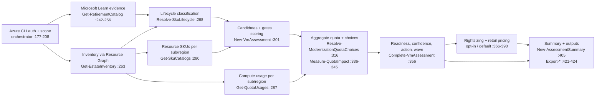

# Repository Audit — VMSKURetirementReport and parent repository

> **Status: audit, with remediation applied on the branch.** The audit itself was read-only: no application code, scripts,
> templates, schemas, dependencies or generated reports were changed to produce it. The remediation is applied step by step
> on the branch and tracked in [§3.0](#30-remediation-status-r8) and §9 (r11: the CI repair, the Windows-only alignment and
> Phases 1-5 are applied; only the push and the first CI run, the release and the owner decisions are open). The register below describes the code as audited (baseline `0b4e8a3`),
> not as it is after the fixes.
>
> | | |
> |---|---|
> | **Audit date** | 2026-10-16 |
> | **Revision** | r2 — adds AUD-033 and AUD-034 after the GitHub Actions run history was checked (r1 had only read the workflow files) and corrects the CI and build ratings. r3 — runs the fault-injection scenarios: AUD-007 and AUD-013 become Confirmed, AUD-013 is re-rated from Medium to Low, and AUD-007 and AUD-016 gain executed evidence. r4 — corrects the image-tag advice in AUD-034 (the floating `7.2-ubuntu-22.04` tag is a stale 2022 build; `lts-7.2-ubuntu-22.04` is PowerShell 7.2.24). r5 — records the owner decision that no further code is changed for Linux or macOS (failures there are reported only) and notes that the CI repair on the branch is verified on Windows only. r6 — supersedes r5: the owner decided that the tool is not intended to run on Linux, macOS or in containers, so those platforms and the PowerShell 7.2 container job are out of scope, CI becomes Windows-only (workflow change pending), and the open Linux and macOS questions are closed. r7 — the owner decided that PowerShell 7.2 and later (7.4 and later included) stay supported: the container job is replaced by a Windows job that runs the complete mock assessment under PowerShell 7.2.24 and 7.4.21 from pinned, checksum-verified archives, the Windows-only workflow and documentation changes are applied on the branch, and the supported-floor question is closed. r8 — applies step 0.1 and Phase 1 on the branch ([§3.0](#30-remediation-status-r8) lists every addressed finding): AUD-001, 005, 006, 016 and 022 are resolved and AUD-003 is partly resolved (the confidence rule; the processor catalog is still to be extended); Phases 2-5 are open. r9 — applies Phase 2 (evidence and diagnostics): AUD-007, 013, 019, 020 and 021 are resolved and the processor catalog is refreshed (AUD-003 stays partly resolved: the older series cannot be generated); Phases 3-5 are open. r10 — applies Phase 3 (selection depth and KPIs): AUD-002, 004, 012, 014 and 015 are resolved; one new finding, AUD-035 (a failed Azure Monitor call is not reported), was found while testing the rightsizing reader, is recorded and is scheduled with step 4.1; Phases 4-5 are open. r11 — applies Phases 4 and 5: AUD-008, 011, 017, 018, 023, 024, 025, 026, 027, 031, 032 and 035 are resolved; one new finding, AUD-036 (`run.log` could hold the signed-in account and object id after an Azure REST failure), was found by the new end-to-end tests, is rated Medium and is resolved; the only in-scope finding left open is AUD-003 (partly resolved). Nothing is pushed and no pull request is open. |
> | **Repository** | `AzaryaShaulov/Azure` (monorepo, 152 tracked files, no submodules) |
> | **Baseline** | branch `modernizationv6`, HEAD `0b4e8a3`, plus 23 **staged, uncommitted** changes (the review-fix batch). `git status` was identical before and after the instrumented test run. |
> | **Primary scope** | `Assessments/VMSKURetirementReport` — tool v1.2.0 (PowerShell 7.2+, read-only Azure VM SKU retirement and modernization assessment) |
> | **Secondary scope** | AVD, azure-arc, AzureDashboards, AzureWorkbooks and `.github` — static checks only (links, secrets, references, structure) |
> | **Remediation scope** | In scope: the VM tool, the root files and `.github`. **Out of scope by owner decision (2026-10-16):** `AVD`, `azure-arc`, `AzureDashboards`, `AzureWorkbooks` — their findings stay in the register for the record but are not scheduled. **Owner decision (2026-10-16) on the supported runtime:** the tool runs through Azure CLI and local PowerShell, as a GitHub Copilot skill and as a standalone script; Linux, macOS and containers are not targets and are out of scope. The committed CI repair stays (it also fixed the Windows job). PowerShell 7.2 and later (7.4 and later included) stay supported. |

## How to read this document

**Path shorthand** used in tables: `SKILL` = `Assessments/VMSKURetirementReport/skills/vm-sku-retirement-report`,
`MOD` = `SKILL/scripts/modules`, `TESTS` = `SKILL/tests`. Other paths are relative to the repository root.

| Term | Meaning |
|---|---|
| **Executed** | I ran the check during this audit and the result is stated as observed. |
| **Code-read** | Verified by reading the cited lines; not executed. |
| **Not tested** | Could not be run here; the validation matrix says what is required. |
| **Confirmed / Probable / Needs validation** | Confirmed = reproduced or proven by the cited evidence. Probable = follows from the code but was not executed. Needs validation = depends on external facts (Azure behaviour, Microsoft documentation). |
| **Critical** | Silent wrong or unsafe outcome on a common path, or a security exposure. **None found.** |
| **High** | Silent, deterministic or order-dependent error in the core recommendation path, or a defect that disables the verification or release path. |
| **Medium** | Real defect with limited reach, or a contract/documentation break that affects integrators or operators. |
| **Low** | Hygiene, minor inconsistency, optional hardening. |

> **Method note.** Five automated read-only reviews produced leads; every lead was re-verified against the code before it
> was kept. Ten leads were refuted or downgraded and are listed in [Appendix A](#appendix-a--refuted-and-unsubstantiated-claims).
> One of them (a "literal `******` Authorization header") was a **tool-output masking artefact**, not a defect — a hex
> dump of the raw bytes shows `"Bearer $tok"` / `"Bearer $token"`. Anyone re-reading this code through a tool that masks
> secrets will see the same artefact.

---

## 1. Repository Audit Summary

### Verdict

* **The VM SKU Retirement tool works as one coherent system on its main path.** Collection → lifecycle classification →
  candidate selection → quota → readiness/confidence → artifacts is connected end to end, the 221-test suite passes locally (never in CI — see below),
  the committed sample matches a fresh regeneration (only `generatedUtc` differs), the 20 summary KPIs reconcile with the VM rows, and a
  static scan found **no mutating Azure call and no secret**.
* **It is not yet fully reliable in its edges.** One **High** defect (an incomplete candidate-cache key makes results
  order-dependent), several **Medium** accuracy and contract issues (hidden larger sizes, vendor heuristic, "Ready" despite
  open reviews, KPIs that disagree with the detail rows, JSON shape that breaks for single-subscription tenants), and
  untested I/O boundaries.
* **The safety net is not working.** CI has failed on every recorded run since the first push (6 of 6): the tool-hash
  lock cannot be verified on a clean runner on any operating system, and the PowerShell 7.2 job references a container
  tag that no longer exists (AUD-033, AUD-034). The 221 tests have so far only ever run on the owner's machine, and the
  tag-triggered release workflow would fail the same way.
* **The parent repository is not yet one consistent system.** Eleven references still point to repositories that no
  longer exist (including links embedded in AVD alert e-mails), the documented dashboard file name does not exist, the
  root `SECURITY.md` is empty, and licensing is per-folder only. The four component folders are outside the agreed
  remediation scope; the root-level items are not.

**36 findings: 0 Critical · 2 High · 13 Medium · 21 Low** (35 at the audit; AUD-035 was added in r10 and AUD-036 in r11). Full register in [section 3](#3-findings-register).

### Scorecard

| Area | Rating | Basis |
|---|---|---|
| Core assessment logic | **Fair → Good** | Sound design and explicit gates; AUD-001 (High), AUD-002/003/006/022 shape the "overly confident" cases |
| Data collection and resilience | **Fair** | Good retry/fallback and graceful degradation (executed); failure *causes* are not persisted and a missing SKU catalog hides the VM detail panels (AUD-007); malformed quota JSON prints an unwrapped error but the run completes (AUD-013) |
| Output and schema contract | **Fair** | Object key sets match the documentation; array/typing and KPI-semantics problems (AUD-004/005/014/016) |
| Documentation (VM tool) | **Good** | Parameters complete, versions consistent, disclaimers present; small schema omissions (AUD-017) |
| Documentation (other components) | **Needs work** | Stale repo URLs, wrong file names, 2 broken links (AUD-009/010/028); these folders are excluded from remediation |
| Tests and CI | **Pipeline broken; good local breadth** | CI failed on 6 of 6 recorded runs (AUD-033, AUD-034); 221 tests pass locally at 72.2 % in-process command coverage; REST/paging/rightsizing/fault paths untested (AUD-008) |
| Security | **Good** | 0 secret-pattern hits, 0 mutating calls, tokens memory-only; policy file missing at repo root (AUD-011) |
| Build, packaging, release | **Fair** | SHA-pinned actions and a verified checksum, but the module-hash lock does not reproduce on clean runners, so the release workflow would fail at tag time (AUD-033); minor packaging hygiene (AUD-025/026/027) |

### Top findings (fix first)

*Status in r10: items 1, 2, 3, 4, 6, 7 and 8 are resolved and item 5 is partly resolved (the confidence rule and a refreshed catalog); see [§3.0](#30-remediation-status-r8). The wording below is the audit-time finding.*

1. **AUD-033 (High)** — CI has never passed: the Pester / PSScriptAnalyzer tree-hash lock fails on all three runners and every test job stops in Bootstrap, so no test runs in CI and no release can be built. *Reproduced locally and in 3 inspected CI runs.* **Resolved (r8).**
2. **AUD-001 (High)** — candidate-cache key omits `DedicatedHostGroupId`; a dedicated-host VM can be reported `Ready`/`HIGH`
   with no Dedicated Host gate, and the result flips with VM enumeration order. *Reproduced.* **Resolved (r8).**
3. **AUD-002 (Medium)** — only the smallest size per series is gated; larger valid sizes are never tried. *Reproduced.* **Resolved (r10).**
4. **AUD-006 (Medium)** — availability-set and scale-set members still show "Proceed with Resize (change window)". *Reproduced.* **Resolved (r8).**
5. **AUD-003 (Medium)** — CPU vendor falls back to a naming heuristic that ignores confidence; `Standard_HB60rs` resolves as Intel. *Reproduced.* **Partly resolved (r8):** confidence now reflects it; the catalog still lacks the older series.
6. **AUD-005 / AUD-004 (Medium)** — single-group `By*` blocks serialize as objects; "Modernize to v6" KPI is 0 while 5 of 7 VMs show a v6 path. *Reproduced.* **AUD-005 resolved (r8); AUD-004 resolved (r10).**
7. **AUD-007 (Medium)** — SKU/quota retrieval failures never reach the report: affected VMs show `Manual Review Required` / `LOW` with no stated cause, and with no SKU data the HTML renders no detail panels. *Reproduced (fault-injection runs).* **Resolved (r9).**
8. **AUD-034 (Medium)** — the PowerShell 7.2 CI job references a container tag that does not exist (`lts-7.2-ubuntu-22.04` is the one that carries 7.2.24), so the stated minimum version is never verified. Owner decisions (r6, r7): containers are out of scope and PowerShell 7.2 and later stay supported, so the job is replaced by a Windows job that checks PowerShell 7.2.24 and 7.4.21. **Resolved (r8), not yet run in Actions.**
9. **AUD-009 / AUD-010 / AUD-011 (Medium)** — stale repo links in AVD alert e-mails and the Arc dashboard, wrong dashboard file name, empty root `SECURITY.md`. (AUD-009 and AUD-010 are in folders the owner excluded from remediation; AUD-011 is not.)

### What is working (verified, do not change unnecessarily)

* **Read-only by construction** — scan of `SKILL/scripts` found no `PUT/PATCH/DELETE`, no mutating `az` verb, no `Invoke-Expression`; the only POSTs are Resource Graph and Azure Monitor queries.
* **Relocation is clean** — no hard-coded local paths (`C:\…`, `/Users/…`, user name) in the project; Copilot `applyTo`, workflows and `build.ps1` use project-relative paths.
* **Reproducible sample** — regenerated with the build's offline settings: 6 of 9 files byte-identical, the other 3 differ only by `generatedUtc`.
* **Contract tests** — the CSV header (87 original columns + 1 appended) is pinned; schema object key sets match the generated JSON (only `LifecycleStage` is undocumented).
* **Defensive evidence handling** — zero-row guards on all three Learn pages, cached-catalog fallback with a visible warning and `Partially Verified` quality, unmapped series surfaced as `Unable to Confirm`.
* **Honest limits** — physical capacity, nested virtualization and temp-disk usage are always `Unable to Verify`; the independent-tool disclaimer is in the JSON, both Markdown reports and every HTML page (CSVs intentionally carry none).
* **Supply chain (partly)** — Actions pinned by SHA with least-privilege tokens; release ZIP checksum verified (`2170836d…97cc`). The Pester / PSScriptAnalyzer version pin works, but its tree-hash check does not reproduce on clean runners (AUD-033).

---

## 2. Component and Dependency Map

### 2.1 Parent repository

| Folder | Tracked files | Purpose | Automation | Audit depth |
|---|---:|---|---|---|
| `Assessments/VMSKURetirementReport` | 64 | VM SKU retirement and modernization assessment (v1.2.0) | CI + release workflows (both failing, AUD-033/034), Pester | **Deep** |
| `AVD` | 54 | Azure Virtual Desktop diagnostics, alerts, Logic App e-mail, insights KQL and runbooks | none | Static (secrets, references, links) |
| `azure-arc` | 12 | Arc-enabled servers dashboard JSON, images, ESU guidance fragment | none | Static |
| `AzureDashboards` | 5 | Azure Update Manager dashboard (7/14/30-day) | none | Static |
| `AzureWorkbooks` | 5 | Arc SQL migration assessment workbook | none | Static (valid JSON) |
| `.github` | 8 | 2 workflows, issue/PR templates, Dependabot (Actions), `QA-agent.agent.md` | — | Reviewed |
| Root | — | `readme.md`, `SECURITY.md` (2 bytes), `.vscode/` | — | Reviewed |

### 2.2 VM SKU tool — execution chain



| Phase | Function (module) | Source of truth | On failure |
|---|---|---|---|
| Evidence | `Get-RetirementCatalog` (Retirement) | 3 Microsoft Learn pages, parsed from HTML | Throws on zero parsed rows → falls back to cached `data/retirement-catalog.json` with a warning; cached evidence is `Partially Verified` |
| Inventory | `Get-EstateInventory` → `Invoke-ArgQuery` (Inventory) | Azure Resource Graph (REST with tenant token, else CLI) | VM query fails fast; ADE/Advisor/Service Health queries use `-AllowFailure` (AUD-019) |
| SKU data | `Get-SkuCatalogs` → `Get-RegionSkuCatalog` (SkuCatalog) | ARM Resource SKUs REST, fallback `az vm list-skus` | Empty catalog → console warning, VMs get no candidates (AUD-007) |
| Quota | `Get-QuotaUsages` → `Get-QuotaUsage` (Quota) | `az vm list-usage` | `$null` usage → `Quota Information Unavailable` |
| Selection | `Find-ReplacementCandidates`, `Test-CandidateGates` (Candidates) | SKU capabilities (API) + migration-guide targets + scoring weights | No candidate → `NoCandidateReason` |
| Decision | `Complete-VmAssessment` (Assessment), `Get-MigrationConfidence`, `Get-DeploymentReadiness` (Scoring) | Gate results, quota status, lifecycle | — |
| Outputs | `Export-AssessmentData`, `Export-ExecutiveSummaryMarkdown`, `Export-DetailedReportMarkdown`, `Export-HtmlReports` (Output) | Assessment objects | Pricing failure discards the incomplete region and completes with one warning (tested) |

### 2.3 Module dependency graph

`Common` is imported by every module. Further imports: `Candidates` → `Retirement`, `SkuCatalog`, `Scoring`;
`Assessment` → `Retirement`, `SkuCatalog`, `Candidates`, `Scoring`, `Quota`; `Output` → `Retirement`, `Assessment`.
`Inventory`, `Quota`, `Scoring`, `SkuCatalog` and `Retirement` import only `Common`; since r10 `Rightsizing` also imports `SkuCatalog` and `Candidates` (it runs the same mandatory checks for its suggested size).
The orchestrator imports all ten modules in one loop (`Invoke-VMSKURetirementReport.ps1:138-140`).

| Module | Responsibility | In-process command coverage | Notes |
|---|---|---:|---|
| `Assessment.psm1` | Per-VM assessment, quota choice, strategy, summary | 88.7 % | AUD-001, 004, 005, 006, 014, 024 |
| `Output.psm1` | CSV/JSON/Markdown/HTML builders | 83.8 % | AUD-004, 015, 018 |
| `Candidates.psm1` | Candidate pool, gates, selection | 83.6 % | AUD-001, 002, 022 |
| `Retirement.psm1` | Learn parsing, lifecycle | 83.4 % | AUD-021 |
| `Quota.psm1` | Usage, aggregate demand, increases | 83.4 % | AUD-013 |
| `Scoring.psm1` | Score, confidence, readiness, wave | 80.3 % | AUD-003, 006 |
| `SkuCatalog.psm1` | Resource SKUs, processor info, prices | 65.0 % | AUD-003, 020 |
| `Inventory.psm1` | ARG paging, VM record | 52.5 % | AUD-019 |
| `Common.psm1` | `az` wrapper, snapshot, helpers | 49.7 % | AUD-013 |
| `Rightsizing.psm1` | Azure Monitor utilization | 27.1 % | AUD-012 |
| `Invoke-VMSKURetirementReport.ps1` | Orchestrator | 0 % in-process (run as a child process by the integration tests) | AUD-007, 008 |

> Coverage is measured **in process** by Pester. Code that runs in the child `pwsh` used by the 36 integration tests, or in
> `ForEach-Object -Parallel` runspaces (`Get-SkuCatalogs`, `Get-QuotaUsages`), is exercised but cannot be instrumented, so
> those figures understate real coverage. Overall: 5,677 of 7,863 commands (72.2 %).

### 2.4 Artifact map

| Artifact | Producer | Consumers / documentation | Verified by |
|---|---|---|---|
| `assessment.json` | `Export-AssessmentData` → `ConvertTo-AssessmentJsonObject` | `references/output-schema.md`; Power BI / Logic Apps / scripts | Integration test; executed key-set and type scan |
| `vm-assessment.csv` (88 columns) | `Export-AssessmentData` ← `ConvertTo-AssessmentRow` | schema doc; Excel | Header order pinned (`TESTS/Integration.Tests.ps1:159-163`) |
| `candidates.csv`, `quota-impact.csv` | `Export-AssessmentData` | schema doc | Executed reconciliation against JSON |
| `retirement-evidence.json` | `Export-AssessmentData` | schema doc | Disclaimer test |
| `executive-summary.md`, `detailed-report.md` | `Export-*Markdown` | people | Integration tests; executed KPI reconciliation |
| `index.html`, `<subscription>-<id>.html` | `Export-HtmlReports` + `SKILL/templates/report.css` | browsers (no scripts) | Executed static id/anchor check (0 issues); cross-browser smoke run before the audit (not re-run) |
| `snapshot/` (opt-in) | `Common.psm1` snapshot helpers | `-FromSnapshot` replay | 6 snapshot integration tests |
| `dist/*.zip` + `.sha256` | `build.ps1 -Task Package` | README download/verify steps; release workflow | Executed checksum match |
| `examples/sample-report/` | `build.ps1 -Task Sample` | README, docs | Executed byte comparison |

### 2.5 Build, CI and release chain

`build.ps1` tasks: `Bootstrap` (locked Pester 6.2.0 / PSScriptAnalyzer 1.24.0, tree-hash verified) → `Lint` → `Version`
(module vs `SKILL.md` vs `CHANGELOG`) → `Test` → `Sample` (offline, fixed as-of `2026-10-05`) → `Package`.
`vm-sku-retirement-report-ci.yml`: Lint/Version/Test on Windows, a PowerShell 7.2.24 and 7.4.21 runtime check on Windows and
Package on Windows (r7; at audit time: a PowerShell 7.2 container job and a Windows, Linux and macOS test matrix). `…-release.yml`: tag `v*.*.*` → verify tag equals tool version → build → `gh release create` with ZIP and checksum.

> **Status (r2).** Neither workflow can currently succeed. In all 6 recorded CI runs the `Lint and test` job stops in
> `Bootstrap` on every operating system (AUD-033) and the PowerShell 7.2 job cannot start (AUD-034). The `Package` job is
> skipped (`needs: test`), and the release workflow runs the same `build.ps1` call, so it has never been triggered and
> would fail. No tag or GitHub Release exists, and `origin/main` still ships only v1.0.0 in `dist/`; v1.2.0 exists only on
> the `modernizationv6` branch.
>
> **Update (r7).** The lock check is repaired on the `modernizationv6` branch (commit "ci: make the tool-integrity lock
> reproducible and fix the PowerShell 7.2 job image"). By owner decision (2026-10-16) Linux, macOS and containers are not
> targets and PowerShell 7.2 and later stay supported, so the workflows are now Windows-only: the Linux and macOS legs and
> the container job are gone, Package and release run on Windows, and a `powershell-compat` job runs the complete mock
> assessment under PowerShell 7.2.24 and 7.4.21 installed from pinned, checksum-verified archives. Verified locally on
> Windows: `actionlint` clean; the job's scripts rehearsed (including a wrong-checksum and a wrong-version case); the full
> gate passes under 7.4.21 and 7.6.7; the offline assessment and the sample regeneration are equivalent under 7.2.24,
> 7.4.21 and 7.6.7. CI has not run since.

---

## 3. Findings register

Columns: Finding ID · Severity · Category · Component · File and line · Finding · Evidence · Impact · Recommended fix · Confidence.
"Executed" evidence was produced during this audit; in-memory experiments imported the repository modules and the test
fixtures and wrote nothing to the repository.

### 3.0 Remediation status (r8)

Status of the findings addressed on the branch `modernizationv6` (nothing is pushed; CI has not run on these changes).
Every row was reproduced with the repository modules before the change and checked after it; the new tests fail against the
previous code and pass now (V-30, V-32, V-34, V-38, V-42). The tests added for AUD-008 describe behaviour that already existed,
so they pass on the previous code by design; V-38 shows that breaking that behaviour makes them fail. The other findings are
unchanged and open, except the five out of scope.

| Finding | Status | Commit | What changed |
|---|---|---|---|
| AUD-033 | Resolved | `c2d0781` | The module-hash check is independent of sort order and installer metadata; locks recomputed |
| AUD-034 | Resolved by replacement | `5194182` | The Linux container job is replaced by a Windows job that checks PowerShell 7.2.24 and 7.4.21 (not yet run in Actions) |
| AUD-001 | Resolved | `e98a12f` | The cache key now includes `DedicatedHostGroupId`, `DiskControllerReported` and `AcceleratedNicCount`; a test fails if candidate selection or scoring reads a VM property that is not in the key |
| AUD-005 | Resolved | `ab958e9` | Every `summary.By*` list is an array for zero, one or many groups |
| AUD-016 | Resolved, one part documented | `ab958e9` | `quota.family`, `quota.regional`, `strategy.ValidationItems` and `strategy.TargetComparison` are always arrays (a one-item list was a bare string); the three CSVs keep their header row when empty. The mixed JSON type of `materialDifferences[].Current/Target` is documented in `output-schema.md`, not changed |
| AUD-006 | Resolved | `bebe8bb` | New next step `Validate Before Resize` when readiness is `Ready` but confidence is below `HIGH`; `Proceed with Resize (change window)` only for `Ready` + `HIGH` |
| AUD-022 | Resolved | `bebe8bb` | An older-generation primary gets the validation item "Newer generation unavailable: ..." when a newer valid size of the family and vendor is restricted or not offered |
| AUD-003 | Partly resolved | `76fe6ea`, `d75802d` | A `Partially Verified` CPU vendor (current or recommended size) adds the validation item "CPU vendor not verified for ..." and lowers confidence. The processor catalog was regenerated with `Update-Catalogs.ps1` (+8 newer series, nothing existing changed). **Still open:** the older series the audit named (original HB, G, F, L, NC) are not on Microsoft's current size-series pages, so the generator cannot produce them; their vendor stays inferred from the name and flagged unverified, and the original HB (AMD) still resolves as Intel |
| AUD-007 | Resolved | `cbe066f` | Every failed Azure read is recorded (what, subscription, region, sanitized cause, effect) and shown in the console, `run.log`, `assessment.json` (`collectionIssues`), the executive summary and an HTML callout; the cause is added to the VM's low-confidence reasons and `RecommendationReason`; a listed VM without a recommendation gets a detail panel that says why |
| AUD-019 | Resolved | `cbe066f` | An optional Resource Graph query (ADE, Advisor, Service Health) that fails or stops part-way is recorded with the number of rows it had |
| AUD-020 | Resolved | `cbe066f` | The 50-page SKU cap is recorded; a REST failure covered by the `az vm list-skus` fallback is noted in `run.log` |
| AUD-013 | Resolved | `9a21655` | Malformed JSON from an exit-0 `az` call returns nothing with "The answer is not valid JSON: ..." instead of throwing; the quota reader records an answer it cannot read |
| AUD-021 | Resolved | `d75802d` | A cached catalog more than 90 days older than the assessment date, and a live parse that lost series or list rows compared with the cache, are flagged in the evidence warning; `-UpdateCache` keeps the cache when a parse looks incomplete |
| AUD-002 | Resolved | `15e378e` | When the smallest size of a series does not qualify for a size-dependent reason (NIC or data disk limit, zone, restriction), up to `primarySelection.maxLargerSizeSteps` (default 2, 0 = off) larger sizes are tried and the first that qualifies is offered as the new `Larger size` variant; the recommendation carries a validation item naming both sizes, and `NoCandidateReason` lists the sizes tried and says that sizes beyond the bound were not evaluated. Series-level failures (generation, controller, security type) never trigger it; nothing changes when the closest size qualifies |
| AUD-004 | Resolved | `660a9e6` | `summary` gains `ModernizationTargetV7/V6` (a target on any path) and `ConvertibleToV7/V6` (conversion first); the executive summary renames the old rows "Direct resize to v7/v6" and prints `not evaluated` for the v6/v7 rows when the modernization check did not run. The sample now reads 5 v6 targets, 5 needing conversion, 0 direct resizes |
| AUD-014 | Resolved | `660a9e6` | `ActionableVms` is added, each grouping heading in the executive summary says which VMs it counts, and `output-schema.md` documents every counter and grouping |
| AUD-015 | Resolved, with a different label | `660a9e6` | The HTML tile, the Subscriptions column, each subscription page and the bottom line all count the Wave 4 VMs and are labelled "Modernization (Wave 4)" / "Wave 4" (the audit proposed "Previous-generation sizes" for the old counter; the Wave 4 count is what the other three places already used, and the evidence-class count stays in the executive summary) |
| AUD-012 | Resolved | `2b7238e` | The suggested half size must pass the same mandatory checks as a migration target and be available for the VM (zone, restriction); constrained-vCPU sizes are never suggested; the choice is in a fixed order; the note says why when no size qualifies and shows the highest hourly maximum next to the P95 of the hourly averages. Also fixed: 0 bytes of available memory was read as low memory use. The percentile helper, the metrics reader and the suggestion are unit-tested and a run with VMs is tested end to end |
| AUD-025 | Resolved by removal | `9ac0a5d` | `PackageHash` is removed from `dependencies.psd1`: nothing could verify it (the build only sees the installed module, which `TreeHash` covers) |
| AUD-026 | Resolved | `9ac0a5d` | The ZIP no longer contains `tests/`; it adds a short package `README.md`, `CHANGELOG.md`, `LICENSE` and `THIRD-PARTY-NOTICES.md` (26 files instead of 35), and `-Task Package` compares the finished ZIP with the skill folder and fails on a missing or unexpected file. The committed `dist/` ZIP was rebuilt on 2026-10-17 (26 files, SHA-256 `f6f3a8f7...98fa`); `npx skills add` still copies the skill folder with `tests/` |
| AUD-027 | Resolved, with a different tag | `9ac0a5d` | CI gains a `sample-diff` job (new `-Task SampleDiff`, which ignores the generation time and line endings) and an informational `browser-smoke` job (Edge, `playwright-core` 1.64.0); the release workflow starts only on tags named `vm-sku-retirement-report-vX.Y.Z` (GitHub cannot filter tags by path). Not yet run in Actions |
| AUD-008 | Resolved | `3757a9c` | The mock `az` gains paging, HTTP 429 throttling, extra VMs, a call log and two Resource Graph faults. New unit tests pin the retry and back-off of `Invoke-AzJson`, Resource Graph paging, chunking and failures over `az` and over REST, and the ARM SKU REST path (token, `nextLink`, retry, fallback). New end-to-end tests run a paged and throttled inventory, a denied page, denied optional queries and the options `-QuotaSafetyPct`, `-RightsizingLookbackDays`, `-SkipHtml` and `-HtmlIncludeOptionalModernization`. The ARM SKU REST path is covered at unit level only: the mock refuses subscription-scoped tokens by design and no production seam was added |
| AUD-035 | Resolved | `3757a9c` | A metrics call that still fails after its retries is recorded once per subscription and region (the reason from the body of the answer and the number of VMs) in `collectionIssues`, the console, `run.log`, the executive summary and the HTML callout; the retirement recommendations are unchanged |
| AUD-036 | Resolved (new in r11) | `3757a9c` | `run.log` is checked after the transcript is closed and email addresses and object ids in it are masked (with `-IncludeOperatorAccount` the account the operator asked to see stays); the shared masker also handles the `\u0027` quote escape of a re-serialized JSON error body |
| AUD-011 | Resolved | `51993ef` | The root `SECURITY.md` mirrors the project policy (private vulnerability reporting, the advisory link of the issue template, the acknowledgement target) with a scope per folder and what is out of scope; no contact address was added |
| AUD-031 | Resolved | `51993ef` | The QA agent's `description` and `argument-hint` say what it does (a read-only audit) and what it expects |
| AUD-017 | Resolved | `3bfd1b7` | `output-schema.md` lists `LifecycleStage` and the 88 CSV columns in file order and says the table is grouped by topic; new tests compare the document with a real run (the keys of eight objects, the column order and the set of grouped columns) |
| AUD-018 | Resolved | `f36041e` | The HTML footer says "Report generated" (neutral dot), or "Report generated with N warning(s)" (amber dot) when the page shows warnings |
| AUD-024 | Resolved | `f36041e` | The unused `-SafetyPct` of `Resolve-ModernizationQuotaChoices` is removed; the README, the methodology and the script help say that `-QuotaSafetyPct` only enlarges the recommended increase, and only when one is needed, and never changes a status; tests pin it |
| AUD-023 | Resolved (list re-validated) | `f36041e` | The named exclusions (Windows Server 2016, Debian, Azure Linux / CBL-Mariner) match the Microsoft Learn page (updated 2026-09-24, checked 2026-10-17); the code records the source and the check date; the validation item states the whole rule, including "any OS not on Microsoft's supported list" and Marketplace images for Linux. A supported-OS allowlist was not added (see the deviations) |
| AUD-032 | Resolved | `f36041e` | Where a SCSI to NVMe conversion rests on an unreported disk controller, the NVMe readiness item and the hover text of the confidence badge say that SCSI was assumed; the confidence level does not change |

**In-scope findings still open after Phase 5 (r11): 1 (AUD-003, Medium, partly resolved)** — 36 recorded (AUD-035 was added in r10 and
AUD-036 in r11), 5 out of scope by owner decision, 30 resolved (2 High, 10 Medium, 18 Low, including AUD-033, AUD-034 and AUD-036).
AUD-003 stays open because the older series the audit named (original HB, G, F, L, NC) are not on Microsoft's current size-series
pages, so their CPU vendor is still inferred from the name and flagged as not verified.

### 3.1 High

| ID | Severity | Category | Component | File and line | Finding | Evidence | Impact | Recommended fix | Confidence |
|---|---|---|---|---|---|---|---|---|---|
| AUD-001 | High | Logic | Candidate evaluation cache | `MOD/Assessment.psm1:73-76` (key), `MOD/Candidates.psm1:146` (gate) | The cache key lists `[bool]$Vm.DedicatedHostId` but not `DedicatedHostGroupId`, which the *Dedicated Host* gate also reads. VMs that differ only by host-group placement share one cached evaluation, so the outcome depends on which VM is evaluated first. The key also omits `AcceleratedNicCount` and `DiskControllerReported` (they change only gate text). | **Executed** (in memory, shared cache as in the orchestrator): plain VM first → host-group VM gets **no** Dedicated Host gate and is `Ready` / `HIGH`; host-group VM first → the plain VM inherits the gate and becomes `Manual Review Required` / `MEDIUM`. One cache entry was created (two expected). | A VM on a dedicated host (automatic placement) can be told to "Proceed with Resize". Results differ between runs when Resource Graph returns rows in a different order. | Add `[bool]$Vm.DedicatedHostGroupId`, `DiskControllerReported` and `AcceleratedNicCount` to `$sig`. Add a unit test that reads every `$Vm.<property>` used by `Candidates`/`Scoring` and fails when one is missing from the key. | Confirmed |
| AUD-033 | High | Build / CI | Test-tool integrity lock; CI job "Lint and test" | `build.ps1:38-53` (`Get-ModuleTreeHash`, sort at `:42`), `:55-62` (`Get-LockedModule`), `:66` (check order); `dependencies.psd1:5,10`; `.github/workflows/vm-sku-retirement-report-ci.yml:58-59`, `vm-sku-retirement-report-release.yml:31` | The integrity check that guards the test tooling cannot be satisfied on a clean machine. `Get-ModuleTreeHash` hashes every file under the installed module folder, sorted with the culture-sensitive `Sort-Object FullName`. That tree contains the install-specific `PSGetModuleInfo.xml`, and culture order differs from ordinal order, so the hash can differ between operating systems (consistent with Pester passing on Windows and macOS but failing on Ubuntu). | **Executed.** GitHub Actions history (`gh`): all 6 recorded "VMSKURetirementReport CI" runs failed (4 pushes to `main`, 2 pull requests). In the 3 runs read in detail, "Lint and test" stops in the Bootstrap step with "failed integrity verification" — Pester on Ubuntu, PSScriptAnalyzer on Windows and macOS — the same module on the same OS each time. Local reproduction with four hash variants: the PSScriptAnalyzer lock equals the hash that includes `PSGetModuleInfo.xml` (dated 2026-02-20) and no variant without it matches; the Pester lock equals only the culture-sorted variant. The three `build.ps1` functions and `dependencies.psd1` are identical on `main` and on the branch. | CI has never passed, so no test runs in CI and nothing is validated on Linux or macOS. The "Package skill" job (`needs: test`) is skipped. The tag-triggered release workflow runs the same build (`vm-sku-retirement-report-release.yml:31`) and would fail, so no GitHub Release can be published. | Make the hash platform-independent: sort relative paths with `[StringComparer]::Ordinal` and exclude install metadata (`PSGetModuleInfo.xml`), or verify the package hash (`PackageHash`, see AUD-025) at download time. Recompute both locks and confirm on the Windows runner; Linux, macOS and containers are out of scope (owner decision, 2026-10-16). | Confirmed |

### 3.2 Medium

| ID | Severity | Category | Component | File and line | Finding | Evidence | Impact | Recommended fix | Confidence |
|---|---|---|---|---|---|---|---|---|---|
| AUD-002 | Medium | Logic | `Find-ReplacementCandidates` | `MOD/Candidates.psm1:283-299` (pruning), `:301` (gates run afterwards) | Only the smallest fitting size per series (plus one capability-preserving variant) is gated and ranked. Size-dependent gates (NIC count, data-disk count, zone/Ultra support, restrictions) are never tried on larger sizes of the same series. | **Executed:** a VM with 3 NICs → every candidate rejected on `NIC Count` (max 2) and `Primary` is empty, although `Standard_D8s_v5` (max 4 NICs) is in the catalog and would pass. With `D4ds_v5`, `D4s_v5`, `D4s_v6` restricted, `D8s_v5` is not evaluated either. | False "no valid candidate / Manual Review Required / LOW", or a cross-vendor fallback, when a same-vendor larger size passes. The report does not say larger sizes were skipped. | After gating, retry the next one or two sizes of a series whose smallest size fails a size-dependent gate or availability (bounded, never down-sizing). State "larger sizes not evaluated" in `NoCandidateReason`. | Confirmed |
| AUD-003 | Medium | Logic | CPU vendor classification and confidence | `MOD/Common.psm1:218`, `MOD/SkuCatalog.psm1:172-205`, `MOD/Scoring.psm1:99-124` | When a series is absent from `processor-catalog.json`, vendor comes from the size-name hint (`a` = AMD, `p` = ARM, otherwise Intel). `Get-MigrationConfidence` never reads `VendorQuality`, although its description says CPU vendor must be verified for `HIGH`. | **Executed:** 42 real size names probed — 41 correct, 26 catalog-verified, 16 heuristic. `Standard_HB60rs` (AMD EPYC) resolves as **Intel**. Heuristic names include older F, G/GS, L, M, NC, H, HC, ND and DC sizes. | An AMD VM judged as Intel: vendor preservation is evaluated against the wrong baseline and confidence can stay `HIGH`. | Extend the processor catalog (or add overrides) for older series and refresh via `scripts/Update-Catalogs.ps1`. Add a validation item "CPU vendor not verified" when current or target `VendorQuality` is not `Verified`. | Confirmed |
| AUD-004 | Medium | Consistency | Summary KPIs | `MOD/Assessment.psm1:705-706`, `MOD/Output.psm1:235` | `ModernizeToV7`/`ModernizeToV6` count only VMs whose modernization *status* is `Modernize to vN` (directly resizable). VMs whose strategic target is a convertible v6/v7 size (Gen1→Gen2 or SCSI→NVMe) are not counted. | **Executed** on the sample: both counters are 0 while 5 of 7 VMs have `ModernizationTargetSku = Standard_D4s_v6` (source `Convertible`). The Markdown estate table prints "Modernize to v6 = 0". | The executive summary reads "no v6 modernization" while the VM table and detail blocks show five v6 paths. | Add `ModernizationTargetV6/V7` and `ConvertibleToV6/V7`, or rename the existing two "Direct resize to v6/v7", and document them. | Confirmed |
| AUD-005 | Medium | Schema | `assessment.json` summary | `MOD/Assessment.psm1:689-725`, `SKILL/references/output-schema.md:19`, `examples/sample-report/assessment.json:147-154,219-222` | `& $grp` returns a one-element array that PowerShell unrolls, so with exactly one group the `By*` property is serialized as an **object**, not an array. | **Executed:** in the sample `BySubscription`, `ByRegion` and `ByCpuVendor` are objects; `ByEvidenceClass`, `ByCurrentSku`, `ByRetirementDate` are arrays. The schema documents every `By*` as `[]`. | Array-iterating consumers (Power BI, `jq`, Logic Apps) break or mis-iterate for a single-subscription or single-region tenant — the most common estate. | Return `, @(...)` (or cast to `[object[]]`) from `$grp`; add a test with one group; record it in the CHANGELOG as a contract correction. | Confirmed |
| AUD-006 | Medium | Logic | Readiness and next step | `MOD/Assessment.psm1:316-333`, `MOD/Candidates.psm1:146-151`, `MOD/Scoring.psm1:126-141` | `Review` gates for Availability Set and VM Scale Set (and temp-disk removal) lower confidence but never change readiness; `NextStep` stays "Proceed with Resize (change window)". Only Dedicated Host, Confidential, GPU, vendor change and unconfirmed lifecycle force manual review. | **Executed** (in memory): plain VM → `Ready`/`HIGH`; availability-set member → `Ready`/`MEDIUM`; scale-set member → `Ready`/`MEDIUM`; availability set + scale set (+ Spot, hibernation) → `Ready`/`LOW`. All say "Proceed with Resize (change window)". | An imperative next step for VMs whose resize may need every VM in the set deallocated, or must go through the scale-set model. | Give Availability Set / VMSS reviews their own readiness or next step ("Validate before resize"), or reword `NextStep` whenever confidence is not `HIGH`. | Confirmed |
| AUD-007 | Medium | Dead end / diagnostics | Data-collection failure reporting | `SKILL/scripts/Invoke-VMSKURetirementReport.ps1:281-282,299`, `MOD/Assessment.psm1:307-311`, `MOD/SkuCatalog.psm1:121-125` | When the Resource SKUs call fails, returns invalid JSON or returns nothing, the only signal is one console `Write-Warning`. Every affected VM gets `recommendation = null`, `Manual Review Required`, confidence `LOW` with **empty** `LowReasons`, an empty `QuotaStatus` and `Not Evaluated` data quality, and the HTML renders **no detail panel** for it (`MOD/Output.psm1:1360` keeps only VMs that have a `Candidates` object). Quota retrieval failures (denied, empty, malformed) print **no warning at all**. The REST-to-CLI fallback logs only at `Write-Verbose`. | **Executed** (r3): 7 runs of the orchestrator against the repository mock `az`, one injected fault each; all exited 0 and wrote every output. **SKU API denied, invalid JSON, empty:** 1-2 generic console warnings ("No SKU data returned ... (permissions or provider registration)", plus the parse error for invalid JSON); the Azure error text is never printed (it showed on the console only because the test wrapper writes past stream redirection, as the repository mock does). 0 of 7 VMs have a recommendation, `LowReasons` is empty, HTML detail rows and toggles are 0 (baseline 6 and 6), the HTML shows only its two standard callouts, the Markdown summary only "Offline mode requested", there is no `collectionIssues`, and in the SKU-denied run `quota-impact.csv` and `candidates.csv` are zero-byte files. The generic warning also reaches `run.log`, which the build strips from the published sample. **Quota API denied, empty, malformed:** 0 warnings (malformed prints one unwrapped `ConvertFrom-Json` error); VMs show `Quota Information Unavailable` or `Manual Validation Required`, readiness `Manual Review Required` for all 7 (baseline: 4 `Quota Increase Required`), and `LowReasons` carries only the effect ("Quota could not be validated"), never the cause. | A reader of the HTML/JSON/CSV cannot tell "no recommendation because evidence was missing" from "no suitable size exists", and the expandable details that would explain the status are missing for every affected VM. | Add `collectionIssues[]` (scope, API, message) to `assessment.json`, the Markdown summary and an HTML callout; put the cause into `LowReasons`; render a detail panel for every listed VM, stating the reason when no candidates exist; warn when quota retrieval fails; write header-only CSVs when there are no rows. | Confirmed |
| AUD-008 | Medium | Testing | I/O-boundary coverage | `TESTS/mock/az.ps1:19,36`, `TESTS/Integration.Tests.ps1:504` | The mock refuses subscription-scoped tokens, so the production ARM SKU REST path never runs in tests; Resource Graph always returns `skip_token = $null` (no paging); `-IncludeRightsizing` runs only with zero VMs (the call is skipped); `-QuotaSafetyPct`, `-RightsizingLookbackDays` and `-SkipHtml` appear in no test, and `-HtmlIncludeOptionalModernization` is covered only through its filter helper (`TESTS/VMSKURetirementReport.Tests.ps1:823-825`); the mock has three modes only (token hang, empty inventory, multi-region). | **Executed:** 221/221 pass; in-process command coverage 72.2 % (5,677/7,863). Lowest: `Rightsizing` 27.1 %, `Common` 49.7 %, `Inventory` 52.5 %, `SkuCatalog` 65.0 %. | Regressions in paging, REST retry/fallback, error handling and rightsizing would not fail CI. | Add injectable REST/token seams and mock modes for paging, 429 throttling, denied, malformed and empty responses; add a rightsizing end-to-end test; cover the untested flags end to end. | Confirmed |
| AUD-009 | Medium | Dead end / stale reference | AVD, azure-arc, AzureWorkbooks | `AVD/AVD-AzAlerts/AVD-AzAlerts-Deploy-Alert-LogicApp.ps1:1337-1339`, `AVD/AVD-SessionHost-Insights-Alerts/AVD-Insights-Alerts-Deploy-LogicApp.ps1:803-805`, `azure-arc/files/AzureArc-EnabledServers.json:695`, `AzureWorkbooks/Arc - SQL Migration Assessment/*.workbook:287`, `REPOSITORY:` headers in 6 AVD scripts | Eleven references still point to the pre-consolidation repositories `AzaryaShaulov/AVD`, `…/azure-arc` and `…/AzureWorkbooks`. | **Executed:** a GitHub search for `user:AzaryaShaulov` returns 7 repositories and none of these three. The AVD deploy scripts write the URLs into the alert e-mail HTML; the Arc dashboard tile loads `markdownUri` from the old repository. | Alert Matrix and Runbook links in AVD alert e-mails, and the Arc ESU-guidance tile, return 404; headers mislead. | *Out of remediation scope (owner decision).* Replace with `https://github.com/AzaryaShaulov/Azure/blob/main/AVD/<folder>/<file>` (target files verified to exist) and `…/azure-arc/files/esuguidelines`; add a link check to CI. | Confirmed |
| AUD-010 | Medium | Documentation / config | AzureDashboards, azure-arc | `AzureDashboards/AUM-UpdateStatus-Dashboard/README.md:43,83`, `…/dist/Azure Update Manager-Dashboard-30d.json:532`, `azure-arc/files/AzureArc-EnabledServers.json:824` | The README documents `dist/azure-update-manager-dashboard.json` as the recommended 30-day file; the file is `Azure Update Manager-Dashboard-30d.json` (spaces, capitals). The 7- and 14-day files use `"location": "global"`, while the 30-day and Arc dashboards keep the unresolved placeholder `"INSERT LOCATION"`. | **Executed** (file listing, grep). | The documented import command fails on the stated path; importing the 30-day file as-is needs an undocumented edit. | *Out of remediation scope (owner decision).* Rename to `azure-update-manager-dashboard-30d.json`, fix the README, and set the location or document the replacement step. | Confirmed |
| AUD-011 | Medium | Security process | Root `SECURITY.md` | `SECURITY.md` (2 bytes), `readme.md:46`, `Assessments/VMSKURetirementReport/SECURITY.md` (2,827 bytes) | The root readme sends readers to `SECURITY.md` for vulnerability reporting but the file is empty. The real policy is in a project subfolder that GitHub does not surface. The advisory link in `.github/ISSUE_TEMPLATE/config.yml:4` does work. | **Executed** (`git ls-files`, byte counts: 2 bytes on disk, 1 in git). History: a policy was added in PR #1 on 2026-10-05, removed the same day (`17348ec`), and an empty file was re-added in `0eac1d8`; `origin/main` has the same empty file. | Reporters find no policy at repository level; scope across components is ambiguous. | Move or mirror the project policy to the root `SECURITY.md` and state the scope per component. | Confirmed |
| AUD-012 | Medium | Logic / testing | Rightsizing (`-IncludeRightsizing`) | `MOD/Rightsizing.psm1:67-103` | The suggestion is any same-series size with exactly half the vCPUs and not `LocationRestricted`: no gates, no zone or quota check; constrained-vCPU sizes share the series key and can match; `Select-Object -First 1` over `.Values` is not deterministic; thresholds use the P95 of **hourly averages**. | Code-read. `Get-VmUtilization` 0 % covered, `Get-Percentile` has no direct test, end-to-end only with zero VMs. | A suggested size may fail the gates that govern the migration target; short bursts are hidden by hourly averaging. | Reuse `Test-CandidateGates`, exclude constrained sizes, sort deterministically, add unit and end-to-end tests, document the heuristic. | Confirmed |
| AUD-034 | Medium | Build / CI | CI job "PowerShell 7.2 runtime compatibility" | `.github/workflows/vm-sku-retirement-report-ci.yml:23-26` | The job that is meant to prove PowerShell 7.2 compatibility runs in the container `mcr.microsoft.com/powershell:7.2.24-ubuntu-22.04`. That tag does not exist, so the job fails at "Initialize containers" before any step runs. | **Executed.** The same "manifest unknown" error in all 3 runs read in detail. The Microsoft Container Registry tag list (4,853 tags) has no `7.2.24-ubuntu-22.04` but does have `7.2-ubuntu-22.04` and `lts-7.2-ubuntu-22.04`. The two differ: `7.2-ubuntu-22.04` is a stale build created 2022-11-03, while `lts-7.2-ubuntu-22.04` (created 2024-11-11, build label `v7.2.24_channel_lts`) is PowerShell 7.2.24. | The documented minimum (README badge, `PSScriptAnalyzerSettings.psd1` `TargetVersions = 7.2`) is never verified; the only cross-version check is dead. PowerShell 7.2 left Microsoft support in November 2024. | Replace the Linux container job with a Windows job that installs PowerShell 7.2.24 (the supported floor) and 7.4.21 from pinned, checksum-verified official archives and runs the complete mock assessment (owner decisions, 2026-10-16: no containers or Linux; PowerShell 7.2 and later stay supported). Applied on the branch (r7); CI has not run since. | Confirmed |
| AUD-036 | Medium | Privacy / diagnostics | `run.log` (the transcript) and the sanitizer of REST error text (added in r11) | `SKILL/scripts/Invoke-VMSKURetirementReport.ps1` (`Start-Transcript`, `Stop-Transcript`), `MOD/Common.psm1` (`ConvertTo-SafeCliMessage`), the REST callers in `MOD/Rightsizing.psm1`, `MOD/Inventory.psm1`, `MOD/SkuCatalog.psm1` | PowerShell writes a caught terminating error to the transcript as it is raised, before the report can sanitize it. The body of an Azure REST error answer names the caller ("The client 'jane@contoso.com' with object id '...' does not have authorization ..."), so after a REST failure (Azure Monitor, a tenant-scoped Resource Graph query, the Resource SKUs call) `run.log` held the signed-in account and its object id unmasked, although the README, `SKILL.md` and `SECURITY.md` say `run.log` masks the account unless `-IncludeOperatorAccount`. The shared sanitizer had a second gap: PowerShell re-serializes a JSON error body and writes each quote as `\u0027`, and the object id after such a quote was not masked. | **Executed (r11):** the end-to-end tests for AUD-035 failed on it (an Azure Monitor 403 with a synthetic body left the account in `run.log`). A real `Invoke-RestMethod` against a local HTTP listener that answered 403 with an Azure-style body, inside `try/catch` with a transcript running, reproduced it: the transcript has `PS>TerminatingError(Invoke-RestMethod): "{ ... \u0027admin@contoso.example\u0027 ... object id \u0027...\u0027 ... }"` while the exception message is only "Response status code does not indicate success: 403 (Forbidden)." | The operator's own account and object id in a file that is shared with the other outputs, on a plausible path (a missing Monitoring Reader role): a documented privacy control is not met. No third-party data. | Check `run.log` once it is closed and mask email addresses and object ids (`Protect-RunLog`; keep the account the operator asked to see), and make the masker handle the `\u0027` form (`Hide-Identity`). Applied in `3757a9c` (V-39). | Confirmed |

### 3.3 Low

| ID | Severity | Category | Component | File and line | Finding | Evidence | Impact | Recommended fix | Confidence |
|---|---|---|---|---|---|---|---|---|---|
| AUD-013 | Low | Reliability | `Invoke-AzJson` / quota retrieval | `MOD/Common.psm1:102-165` (parse at `:142`), `MOD/Quota.psm1:4-33` | `-AllowFailure` covers only a non-zero exit code; malformed JSON from an exit-0 `az` call throws. `Get-QuotaUsage` has no `try/catch` and runs inside `ForEach-Object -Parallel`, so the error is raised per pair and the pair is absent from the usage map. The SKU path handles the same fault with a clean warning (`Get-SkuCatalogs`), so the two paths are inconsistent. | **Executed** (r3, `usage-garbage` run): the run completes with exit 0 and quota becomes `Quota Information Unavailable` or `Manual Validation Required`; the only console output is one unwrapped `ConvertFrom-Json` error record with no subscription or region. | Graceful degradation, but an unexplained raw error; together with AUD-007 the reader cannot tell why quota is missing. Re-rated from Medium after execution. | Wrap the parse in `try/catch` when `-AllowFailure` is set (return `$null`, sanitized message that names the scope); add tests. | Confirmed |
| AUD-014 | Low | Documentation | Summary `By*` denominators | `MOD/Assessment.psm1:689-731` | `ByEvidenceClass`, `ByWave`, `ByMigrationPriority` cover all VMs; `BySubscription`, `ByRegion`, `ByCurrentSku`, `ByRecommendedSku`, `ByCpuVendor`, `ByDeploymentReadiness` cover only VMs with an action. | **Executed:** 7 VMs scanned, `BySubscription` sums to 6. | Totals do not reconcile to `TotalVmsScanned`; undocumented. | State the scope per group in `output-schema.md` or add an `ActionableVms` count. | Confirmed |
| AUD-015 | Low | Terminology | HTML KPI tile | `MOD/Output.psm1:1287` vs `:234`, `MOD/Scoring.psm1:153,185` | The tile "Optional modernization" prints `ModernizationRecommended` (evidence class), while `ModernizationOptional` (action) is a different counter. Capacity-limited previous-generation sizes are counted in the tile yet have action `Plan Migration` and land in Wave 4. | Code-read. | Two numbers under one label family; mandatory-leaning VMs presented as optional. | Rename the tile ("Previous-generation sizes") and align the counters. | Confirmed |
| AUD-016 | Low | Schema | JSON value types | sample `assessment.json` | `strategy.ValidationItems` is `null` for 2 VMs and `TargetComparison` is `null` for 1 (documented as arrays). `materialDifferences[].Current/Target` and `TargetComparison.*` mix string, number, boolean and null in one field (11 paths). | **Executed:** type scan of 940 JSON paths. Fault runs (r3) add: with no SKU data `quota.family` and `quota.regional` are `null`, and `quota-impact.csv` and `candidates.csv` are zero-byte files with no header row. | Typed consumers (Power BI, Parquet) infer inconsistent column types. | Emit `[]` instead of `null` (including `quota.family` and `quota.regional`); write header-only CSVs when there are no rows; stringify heterogeneous values or add typed companions. | Confirmed |
| AUD-017 | Low | Documentation | Schema document | `SKILL/references/output-schema.md:26-28,128` | The `lifecycle` object omits `LifecycleStage` (present in JSON). The text says CSV columns "are written in the order listed", but the grouped table places `CurrentVcpu`/`CurrentMemoryGB` earlier than they appear (39 positional differences). The column **set** is identical (88 of 88). | **Executed.** The integration test pins the real order (`TESTS/Integration.Tests.ps1:159-163`). | Integrations built from the table would mis-order columns. | Add `LifecycleStage`; replace the table with the ordered list or say "grouped by topic". | Confirmed |
| AUD-018 | Low | Reporting | HTML footer | `MOD/Output.psm1:521` | The footer always says "Report generated successfully", regardless of evidence warnings, replayed data or partial collection. | Code-read. | Reads as a quality statement. | Show "Report generated" plus the number of warnings, or remove. | Confirmed |
| AUD-019 | Low | Reliability | Optional Resource Graph queries | `MOD/Inventory.psm1:48,190-195` | With `-AllowFailure` (ADE, Advisor, Service Health) a failure after page 1 returns the partial rows with only `Write-Verbose`. | Code-read. | ADE/Advisor corroboration may be incomplete without notice (effect limited to Info gates and notes). | Warn when a paged optional query is truncated. | Confirmed |
| AUD-020 | Low | Reliability | SKU REST paging | `MOD/SkuCatalog.psm1:111,121-125` | The loop stops after 50 pages without a warning; REST failures fall back silently (`Write-Verbose`). | Code-read. | Theoretical partial catalog; the fallback hides REST problems. | Warn when the cap is reached; record the REST-to-CLI fallback in the run log. | Needs validation |
| AUD-021 | Low | Data currency | Retirement catalog | `MOD/Retirement.psm1:247-250,385-428` | Zero-row guards exist, but a *partial* parse (some rows dropped) is not detected, and the cached catalog has no maximum age (current `generatedUtc` 2026-10-06). Cached evidence is `Partially Verified`, so confidence cannot reach `HIGH`. | Code-read. | Stale or partial evidence may not stand out. | Compare series counts with the cached catalog and warn on regression; warn when the cache is older than a set number of days. | Confirmed |
| AUD-022 | Low | Logic | Primary selection | `MOD/Candidates.psm1:349-369`, `SKILL/references/methodology.md:215` | The "no ageing fallback" rule applies to the secondary; the primary may fall back to an older generation when newer sizes are restricted and still be `Ready`/`HIGH`. | **Executed:** `Standard_D4s_v3` with `D4ds_v5`/`D4s_v5`/`D4s_v6` restricted → primary `Standard_D4ds_v4`, `Ready`/`HIGH`. | An older-generation target with no validation note. | Add a validation item when the primary generation is below the newest offered. | Confirmed |
| AUD-023 | Low | Assumption | Gen1 to Trusted launch upgrade | `MOD/Assessment.psm1:364,390-395` | The redeploy decision rests on a static guest-OS pattern (Windows Server 2016, Debian, CBL-Mariner, Azure Linux). | Code-read; not compared with current Microsoft documentation. | Unlisted unsupported OS/image combinations are reported as "Convertible". | Re-validate the list against Learn each release; surface "guest OS unknown/unsupported" explicitly. | Needs validation |
| AUD-024 | Low | Dead code / semantics | `SafetyPct` and `-QuotaSafetyPct` | `MOD/Assessment.psm1:147-160` | `Resolve-ModernizationQuotaChoices -SafetyPct` is accepted and ignored (analyzer suppression). `-QuotaSafetyPct` only enlarges the *recommended increase*; "Quota OK" ignores thin headroom. | Code-read; AST scan: the only unused parameter among 130 functions. | The parameter can be misread as a safety buffer. | Remove the dead parameter or document the semantics precisely. | Confirmed |
| AUD-025 | Low | Config | Dependency lock | `dependencies.psd1:4,9`, `build.ps1:55-62` | `PackageHash` is recorded but never verified; only `TreeHash` is — and that is the part that fails on clean runners (AUD-033). A package-level hash would be platform-independent. | **Executed** (grep). | Implies an integrity check that does not exist. | Verify it or delete it. | Confirmed |
| AUD-026 | Low | Packaging | Release ZIP | `build.ps1:163-166` | `Copy-Item $skill` ships `tests/` (Pester files, fixtures, mock `az.ps1`) but no README or CHANGELOG; top level holds only `SKILL.md`, `LICENSE`, `THIRD-PARTY-NOTICES.md`. | **Executed:** 35 files, 199,027 bytes; checksum matches. | Customers receive test scaffolding and no readme. | Exclude `tests/`; add the README. | Confirmed |
| AUD-027 | Low | CI | Workflows | `.github/workflows/vm-sku-retirement-report-ci.yml:3-13`, `…-release.yml:3-5` | CI does not run `Sample` (reproducibility) or `tools/browser-smoke.js`; `push` is limited to `main` (pull requests are unfiltered); the release tag filter `v*.*.*` is repository-wide. | Code-read. Sample reproducibility was checked manually (byte-identical). | Sample or HTML drift would go unnoticed in CI. | Add a sample-diff job (ignore `generatedUtc`), an optional browser smoke job, and scope the tag filter. | Confirmed |
| AUD-028 | Low | Documentation | Broken links | `AVD/README.md:76`, `AVD/AVD-SessionHost-Insights/README.md:139` | Both link to `AVD-Insights-Alerts-Runbook.md`; the file is `AVD-hosts-Insights-Alerts-Runbook.md`. | **Executed:** 34 Markdown files scanned, 2 broken relative links. | 404 inside the docs. | *Out of remediation scope (owner decision).* Correct the file name. | Confirmed |
| AUD-029 | Low | Hygiene | azure-arc assets | `azure-arc/images/Azure Arc-enabled Servers.png`, `…-ESU.png`, `azure-arc/files/esuguidelines`, `azure-arc/images/dashbaordready5.jpg` | Two PNGs are unreferenced; `esuguidelines` has no extension and is referenced only through the stale URL (AUD-009); one file name has a typo. | **Executed** (reference search). | Clutter and confusion. | *Out of remediation scope (owner decision).* Remove or rename after AUD-009 is fixed. | Confirmed |
| AUD-030 | Low | Governance | Licences | repo root, `AVD/LICENSE`, `AzureWorkbooks/LICENSE`, project `LICENSE` | No root licence; `azure-arc` and `AzureDashboards` have none; the root readme defers to the individual projects. | **Executed** (`git ls-files`). | Unclear reuse terms for two folders. | *Folder licences are out of remediation scope (owner decision); a root licence remains an open choice.* Add a root licence or one per folder. | Confirmed |
| AUD-031 | Low | Hygiene | QA agent definition | `.github/agents/QA-agent.agent.md:3-4` | The front matter still has template placeholders ("Describe what this custom agent does…"). | Code-read. | Poor agent discoverability. | Fill in `description` and `argument-hint`. | Confirmed |
| AUD-032 | Low | Assumption | Disk-controller default | `MOD/Inventory.psm1:294-296`, `MOD/Candidates.psm1:84-89` | A missing `diskControllerType` is treated as SCSI (the documented platform default) and passes the gate; `DiskControllerReported` never reduces confidence. Every VM in the sample is "not reported". | **Executed** (sample) and code-read. | Low risk; confidence is unchanged when the controller was inferred. | Optional: mention the inference in the confidence tooltip. | Confirmed |
| AUD-035 | Low | Diagnostics | Rightsizing metrics reader (added in r10) | `MOD/Rightsizing.psm1:40-44` (retry loop), `Invoke-VMSKURetirementReport.ps1:367-382` | A metrics call that fails all three attempts (a missing Monitoring Reader role, HTTP 403, a persistent 429) is only written to the verbose stream and skipped, so `Get-VmUtilization` returns no entry for its VMs and each shows `Insufficient Data` ("Less than 7 days of hourly metrics (or metrics unavailable)"). Only a failure to get the token throws and reaches `collectionIssues`. | **Executed (r10, V-36):** the mock estate with every Azure Monitor call answering 403 — exit 0, the four rightsizing targets show `Insufficient Data`, `collectionIssues` is `[]`, nothing on the console. The unit test "gives up on a call after three attempts and returns no data for its VMs" pins the behaviour. | An operator without the documented Monitoring Reader role cannot tell a permission problem from young VMs. Opt-in feature and the note says "or metrics unavailable", so the harm is limited. | Record each failed call with `Add-CollectionIssue` (subscription, region, sanitized reason, effect "These VMs show Insufficient Data for rightsizing") through an optional sink parameter, as for the other reads; scheduled with step 4.1. | Confirmed |

---

## 4. Inconsistency Report

### 4.1 Reconciliations that passed (executed unless noted)

| Check | Result |
|---|---|
| README parameter table vs the script `param` block | 24 of 24 user-facing parameters are documented; `RemainingArguments` is the internal double-dash catch-all (covered by two integration tests). `SKILL.md` is a deliberate subset (it omits `-OutputPath`, `-RightsizingLookbackDays`, `-IncludePricing`). |
| Version | `Common.psm1` = `SKILL.md` metadata = latest `CHANGELOG` = `assessment.json` `toolVersion` = ZIP name = **1.2.0**; no stale `1.1.x` strings outside the CHANGELOG (code-read + grep). |
| Schema object key sets vs generated JSON (`tenant`, `current`, `candidate`, `gates`, `materialDifferences`, `VmQuota`, `QuotaRow`, `strategy`, `modernization`) | Exact match. Only `lifecycle.LifecycleStage` is undocumented (AUD-017). |
| CSV column **set** | 88 of 88 present in both the document and the file; the order statement is inaccurate (AUD-017). |
| Summary KPIs vs `vm-assessment.csv` | 20 of 20 scalar metrics reconcile (affected, retired, urgency buckets, quota, readiness, confidence, …). |
| Quota artifacts | Per scope, the sum of family-row `VmCount` equals the regional-row `VmCount`; 8 CSV rows = 5 family + 3 regional JSON rows; Retirement regional `RequiredVcpu` (4) = sum of per-VM `SteadyStateRegionalRequiredVcpu` (4). No double-counting across the three scopes. |
| Candidates | `candidates.csv` Primary 5 / Secondary 5 / Third 2 = `vm-assessment.csv` `RecommendedSku` 5 / `AlternativeSku` 5 / `ThirdCandidateSku` 2. |
| Disclaimer | Present in `assessment.json`, `retirement-evidence.json`, both Markdown reports, `index.html` and the subscription page; absent from the three CSVs by documented design. |
| Placeholders | 0 placeholder-like values in `vm-assessment.csv`; three columns are empty for every sample row (`VendorChangeReason`, `RightsizingStatus`, `RightsizingSuggestedSku`) because the sample has no vendor change and no rightsizing run. |
| HTML static integrity | 29 + 9 ids with 0 duplicates; 9 + 9 internal hrefs with 0 missing targets; 7 `label for` targets exist; 0 `<script>`, 0 inline handlers; external hosts limited to `learn.microsoft.com` and `github.com`. |
| Local paths after relocation | None in the project; `applyTo: "Assessments/VMSKURetirementReport/**"` in the Copilot instructions matches the current location. |
| Sample freshness | Regenerated with the build's offline settings: 6 of 9 files byte-identical; the other 3 differ only by `generatedUtc`. **No stale artifact.** |

### 4.2 Inconsistencies found

| Topic | Conflict | Where | IDs |
|---|---|---|---|
| Modernization KPI vs detail | Summary says 0 v6/v7 moves; five VMs show a v6 target | `MOD/Assessment.psm1:705-706` vs strategy rows | AUD-004 |
| KPI label vs counter | Tile "Optional modernization" is `ModernizationRecommended`; `ModernizationOptional` is a different count | `MOD/Output.psm1:234,1287` | AUD-015 |
| Wave 4 definition | "Wave 4 is optional modernization and is never mixed with retirement requirements" (`Output.psm1:247`) yet action `Plan Migration` (capacity-limited previous-gen) is placed in Wave 4 | `MOD/Scoring.psm1:153,185` | AUD-015 |
| Summary denominators | Some `By*` groups count all VMs, others only VMs with an action | `MOD/Assessment.psm1:689-731` | AUD-014 |
| JSON shape vs schema | Single-group `By*` objects vs documented arrays; `null` vs `[]`; mixed value types | sample `assessment.json`, `output-schema.md:19` | AUD-005, 016 |
| Confidence description vs behaviour | Description requires verified CPU vendor for `HIGH`; the function never checks vendor quality | `MOD/Scoring.psm1:99-124` | AUD-003 |
| Dependency lock | `PackageHash` recorded but unused; the verified `TreeHash` does not reproduce on clean runners | `dependencies.psd1`, `build.ps1:38-62` | AUD-025, AUD-033 |
| Supported PowerShell floor | README and analyzer settings claim 7.2+; the only CI job that tests 7.2 cannot start | README badge, `PSScriptAnalyzerSettings.psd1`, `ci.yml:23-26` | AUD-034 |
| Repeated default | The safety margin default `20` is repeated in five signatures (orchestrator, `Get-QuotaIncrease`, `New-QuotaImpactRow`, `Measure-QuotaImpact`, `Resolve-ModernizationQuotaChoices`); no conflict today, but a change in one place would not propagate | `MOD/Quota.psm1`, `MOD/Assessment.psm1:159`, orchestrator `param` | observation |
| Other components | Documented file name vs real file; stale repository URLs; wrong runbook link; empty security policy | AUD-009, 010, 011, 028 | — |

---

## 5. Dead-End Analysis

### 5.1 Unused code, parameters and configuration

| Item | Evidence | Verdict |
|---|---|---|
| Functions | AST scan (executed earlier in the audit): 130 functions across modules and scripts; every production function has at least one call site | **No orphaned function** |
| `Resolve-ModernizationQuotaChoices -SafetyPct` | `MOD/Assessment.psm1:147-160` | Dead parameter, kept for compatibility (AUD-024) |
| `PackageHash` | `dependencies.psd1:4,9` | Unused configuration (AUD-025) |
| `RemainingArguments` | orchestrator `param` (line 114) | Intentional: turns `--check-modernization` into a helpful error or the opt-in flag |
| Direct test references | 67 of 128 module functions have no *direct* test reference | Misleading on its own — most run through callers or the end-to-end test; see 5.3 for what truly never runs |

### 5.2 Orphaned and stale artifacts

* Three screenshots (`report-cross-vendor.png`, `report-sku-families.png`, `report-waves.png`) illustrated sections that no longer exist; they are already staged for deletion. The three remaining images are all referenced by `README.md` (lines 17, 55, 60).
* `azure-arc`: two unreferenced PNGs and an extensionless `esuguidelines` file (AUD-029).
* `examples/sample-report/` is current (byte-identical to a regeneration).

### 5.3 Workflows that cannot fully complete, or complete without saying so

| Flow | Outcome | Where information is lost | IDs |
|---|---|---|---|
| Resource SKUs unavailable for a scope | Run completes (exit 0); VMs → `Manual Review Required` / `LOW`; no detail panels; zero-byte `candidates.csv` and `quota-impact.csv` (**executed**) | The cause never reaches an artifact; `LowReasons` empty | AUD-007 |
| Quota API denied, empty or malformed | Run completes; quota `Unavailable`; **no console warning**, except one unwrapped error record for malformed JSON (**executed**) | Cause and scope are never reported | AUD-007, AUD-013 |
| Optional ARG query fails mid-paging | Partial rows returned silently | ADE/Advisor corroboration | AUD-019 |
| Learn page layout changes | Total failure is guarded (throw → cached catalog + warning); a partial parse is not detected | Series dropped silently | AUD-021 |
| `-IncludeRightsizing` with VMs | `Get-VmUtilization` and `Get-Percentile` are **executed by no test** (the zero-VM test skips the call, orchestrator `:367`); any failure is downgraded to a warning (`:376`) | Cause and metrics detail | AUD-012 |
| Pricing failure | Incomplete region discarded, run completes with one warning | None (tested) | — |
| Snapshot record and replay | Tested end to end (6 tests) | None | — |
| HTML interactions | No scripts; "Expand all" is a CSS checkbox; static integrity check clean; cross-browser smoke (14 checks × Edge, Firefox, WebKit) passed before the audit (not re-run) | — | — |
| CI on push and pull request | Fails before any test runs (hash lock; missing 7.2 image); "Package skill" is skipped; the release workflow would fail the same way | The whole CI safety net | AUD-033, AUD-034 |

### 5.4 Information-loss points, collection → report

| Stage | Collected | Lost or not consumed | IDs |
|---|---|---|---|
| Candidate pool | Every size offered in the region | Larger sizes of a series are pruned before gating | AUD-002 |
| Processor lookup | `VendorQuality`, `ArchitectureQuality` | Not used by confidence or readiness | AUD-003 |
| Collection | Failed or empty API calls | Not persisted in any artifact | AUD-007, 019, 020 |
| Inventory | `HyperVGenerationSource` (instance view vs OS disk), `DiskControllerReported` | In JSON only; neither affects confidence | AUD-032 |
| Candidate cache | Per-VM attributes | `DedicatedHostGroupId`, `DiskControllerReported`, `AcceleratedNicCount` ignored by the key | AUD-001 |
| Quota | `-QuotaSafetyPct` | Affects only the recommended increase | AUD-024 |

---

## 6. Functional Gap Analysis

| Feature (where exposed) | State | Gap | IDs |
|---|---|---|---|
| `-IncludeRightsizing` (README, SKILL) | Implemented | No test with VMs; suggestion ignores gates; hourly-average P95 | AUD-012, 008 |
| `-QuotaSafetyPct` (README) | Implemented for the recommended increase | "Quota OK" has no headroom buffer; appears in no test | AUD-024, 008 |
| `-SkipHtml`, `-HtmlIncludeOptionalModernization` | Implemented | `-SkipHtml` appears in no test; the optional-modernization listing is covered only through its filter helper (`Test-HtmlListedVm -IncludeOptional`) | AUD-008 |
| `--check-modernization` convertible paths | Implemented (Gen1→Gen2, SCSI→NVMe, redeploy review) | Summary counters omit convertible targets; guest readiness is text only (documented) | AUD-004 |
| Dedicated Host handling | `Review` gate plus Learn "ADH" entries shown as notes | The host SKU is not evaluated (documented: "verify separately"); the gate can be lost through the cache | AUD-001 |
| Microsoft lifecycle stages | Retired / End of Life / Not End of Life / Unknown | *Current* and *Extended* not distinguished — documented in `Get-LifecycleStage` | by design |
| Capacity, nested virtualization, temp-disk usage, network bandwidth | Always `Unable to Verify` / `Unknown` | Control-plane limits; documented | by design |
| Sorting, filtering, export in HTML | None exist | No gap against the documentation | — |
| AVD alert e-mail links; Arc ESU tile | Implemented | Point to repositories that no longer exist | AUD-009 |
| Update Manager dashboard import (README) | Documented | Wrong file name; unresolved location placeholder | AUD-010 |

---

## 7. Azure VM SKU Retirement and Modernization Logic

### 7.1 Basis of each decision

**Verified** = read from an Azure API in the customer's subscription. **Documented** = a Microsoft platform rule encoded
in the tool. **Assumed** = a tool heuristic or an embedded list.

| Topic | Verified (API) | Documented constraint | Assumed (embedded) | Overconfidence risk |
|---|---|---|---|---|
| Retiring / retired identification | — | Microsoft Learn retired, End-of-Life and migration-guide pages (HTML-parsed) | `series-map.json` (38 series, 14 composite names) maps Learn names to SKU patterns | Partial parse not detected (AUD-021); unmapped series are surfaced, not guessed |
| Dates and lifecycle | — | Learn planned retirement date; `Already Retired` beats a future date (`Retirement.psm1:529`) | Urgency buckets and waves; `-HorizonMonths` | Cached catalog has no age limit (AUD-021) |
| Direct-resize compatibility | VM generation, controller, NICs, disks, premium/Ultra, accelerated networking, ephemeral OS, security type (Resource Graph); target capabilities (Resource SKUs) | Resize may need deallocation or cluster move | Gate set and severity (`Fail`/`Review`/`Info`) | `Ready` despite open reviews (AUD-006) |
| Replacement SKU | Target availability and restrictions | Migration-guide target series | Smallest fitting size per series; score weights; same-vendor preference | Hidden larger sizes (AUD-002); cache key (AUD-001) |
| v5 / v6 / v7 modernization | Same as above | v6/v7 same-family targets | "Two generations behind" optional threshold; v4-or-older heuristic (`methodology.md:134,434`) | Counters (AUD-004) |
| CPU vendor and architecture | Architecture (`CpuArchitectureType`) | — | Vendor from the curated processor catalog, else the name hint | Heuristic ignored by confidence; `HB60rs` (AUD-003) |
| Gen1 vs Gen2 | Instance view, else OS disk (`Inventory.psm1:262-265`) | Gen2-only targets cannot host Gen1 in place | Gen1→Trusted launch OS-support pattern (`Assessment.psm1:364`) | List can go stale (AUD-023) |
| SCSI vs NVMe | `diskControllerType` | Missing value means SCSI | — | Inference not reflected in confidence (AUD-032) |
| Regional availability | `restrictions`, `locationInfo` (Resource SKUs) | — | — | Availability is not capacity; stated as `Unable to Verify` |
| Quota | `az vm list-usage` (family and `cores`) | Resize into another family needs full family quota; same family needs the delta | In-place vs side-by-side model; 20 % margin on recommended increases | `Quota OK` has no buffer (AUD-024) |
| Redeployment | — | — | Static OS pattern | AUD-023 |
| Manual validation | Nested virtualization, temp-disk use, licensing, guest drivers | — | Always flagged `Unknown` / `Review` | Appropriately conservative |

### 7.2 Scenarios that can produce incomplete, misleading or over-confident output

| Scenario | Observed or expected output | Evidence | ID |
|---|---|---|---|
| Dedicated-host (automatic placement) VM evaluated after a plain VM of the same size | `Ready` / `HIGH`, no Dedicated Host gate | Executed | AUD-001 |
| Estate where the smallest fitting size fails a size-dependent gate | "All candidates fail mandatory requirements", no primary | Executed | AUD-002 |
| AMD HPC VM without `a` in the size name (`Standard_HB60rs`) | Treated as Intel | Executed | AUD-003 |
| Availability-set or scale-set member | "Proceed with Resize (change window)" with `MEDIUM`/`LOW` | Executed | AUD-006 |
| Newer sizes restricted for the subscription | Older-generation primary, `Ready` / `HIGH` | Executed | AUD-022 |
| Single-subscription tenant consuming `summary.BySubscription[]` | Object instead of array | Executed | AUD-005 |
| Executive reader of the estate table | "Modernize to v6 = 0" next to five v6 paths | Executed | AUD-004 |
| `Microsoft.Compute/skus/read` denied or provider unregistered | Every VM `LOW` / manual review, no stated cause, no detail panels | Executed | AUD-007 |
| Learn restructures one table (partial parse) | Series silently missing from the catalog | Code-read | AUD-021 |
| `-IncludeRightsizing` on a bursty VM | "Potential Rightsizing Opportunity" with an ungated size | Code-read | AUD-012 |
| Quota used at 99 % after the move | `Quota OK` | Code-read | AUD-024 |

---

## 8. Risk Register

| Risk | Description | Likelihood | Impact | Severity | Findings | Mitigation |
|---|---|---|---|---|---|---|
| R-01 | A dedicated-host VM is told to resize, or results differ between runs | Medium | High | **High** | AUD-001 | Fix the cache key; add the key-completeness test |
| R-02 | Valid same-vendor size missed → false "no candidate" or an unnecessary CPU-vendor change | Medium | Medium | Medium | AUD-002, 022 | Bounded size expansion; disclose skipped sizes |
| R-03 | CPU vendor mis-classified for older series | Low | Medium | Medium | AUD-003 | Extend processor catalog; confidence rule |
| R-04 | Integrations break for single-subscription tenants | High | Medium | Medium | AUD-005, 016, 017 | Force arrays; type tests; correct the schema document |
| R-05 | Executive KPIs contradict detail rows | High | Medium | Medium | AUD-004, 014, 015 | Add strategic-target counters; rename tiles |
| R-06 | Operators act on "Ready" without noticing set or scale-set effects | Medium | Medium | Medium | AUD-006 | Distinct readiness / next-step wording |
| R-07 | Collection problems look like "no suitable size" | Medium | Medium | Medium | AUD-007, 013, 019, 020 | Persist `collectionIssues[]`; harden `Invoke-AzJson` |
| R-08 | Regressions in untested I/O paths ship | Medium | Medium | Medium | AUD-008, 012 | Fault-injection mock, paging and rightsizing tests |
| R-09 | Stale or partially parsed Microsoft evidence | Low | High | Medium | AUD-021, 023 | Catalog regression and age checks; periodic list review |
| R-10 | Broken operator links in AVD alert e-mails and the Arc tile | High | Low | Medium | AUD-009, 028 | Out of remediation scope (owner decision); recorded only |
| R-11 | Documented dashboard import fails | High | Low | Medium | AUD-010 | Out of remediation scope (owner decision); recorded only |
| R-12 | No discoverable vulnerability-reporting policy | Medium | Medium | Medium | AUD-011 | Root `SECURITY.md` |
| R-13 | Sample or HTML drift unnoticed | Low | Low | Low | AUD-027 | Sample-diff and smoke jobs |
| R-14 | Ambiguous reuse terms for two folders | Low | Low | Low | AUD-030 | Folder licences out of remediation scope; a root licence is an open choice |
| R-15 | CI never passes: no cross-platform signal, and no release can be built | High | High | **High** | AUD-033 | Repair the lock check first; require a green run before merging |
| R-16 | The PowerShell 7.2 floor is unverified | Medium | Medium | Medium | AUD-034 | Floor kept at 7.2 (owner decision); checked by a Windows job on 7.2.24 and 7.4.21 |

---

## 9. Remediation Plan

> **Applied so far (r11): step 0.1 and Phases 1 to 5** — see [§3.0](#30-remediation-status-r8). Steps 5.1 and 5.2 are out of scope; a root licence (part of 5.3) is an owner choice. Phases are ordered by risk reduction and dependency. Every code phase ends with the
> same regression gate; documentation-only phases need only the link check.

**Scope (owner decision, 2026-10-16):** `AVD`, `azure-arc`, `AzureDashboards` and `AzureWorkbooks` are **not** in scope for
remediation. Their findings (AUD-009, 010, 028, 029 and the folder-level part of AUD-030) stay in the register for the
record; steps 5.1 and 5.2 are therefore not scheduled.

**Regression gate for every code phase:** `./build.ps1 -Task Lint,Version,Test` stays green (474 tests after Phase 5) and, once step 0.1 is done, the Windows CI job is green; regenerate
the sample (`-Task Sample`) and review the diff — only intended changes (`-Task SampleDiff` checks that the committed sample matches a fresh build); `-Task Package` and verify the checksum; run
`tools/browser-smoke.js` when HTML or CSS changes; add a CHANGELOG entry and update `output-schema.md` when a contract changes.

| Phase | Step | Findings | Change | Tests to add | Depends on |
|---|---|---|---|---|---|
| **0** | Publish this audit | — | Add `docs/REPOSITORY_AUDIT.md` (no code change) | — | — |
| **0b — Safety net** | 0.1 | AUD-033, 034 | Make the module-hash check platform-independent (ordinal sort and no install metadata, or verify the package hash); recompute both locks; remove the Linux and macOS matrix entries and the container job, run Package and release on a Windows runner, and add a Windows job that checks PowerShell 7.2.24 and 7.4.21 (Linux, macOS and containers are out of scope and 7.2 and later stay supported — owner decisions, 2026-10-16); confirm the Windows jobs are green | The CI run itself | — |
| **1 — Core correctness** | 1.1 | AUD-001 | Complete the candidate-cache key | Two VMs sharing a cache (both orders); AST test that every `$Vm.<property>` read by `Candidates`/`Scoring` is in the key | — |
| | 1.2 | AUD-005, 016 | `$grp` always returns arrays; `[]` instead of `null` (including `quota.family` and `quota.regional`); header-only CSVs when empty; stringify or type heterogeneous values | JSON-shape tests with 0, 1 and many groups | — |
| | 1.3 | AUD-006, 022 | "Validate before resize" readiness or next step for Availability Set / VMSS; validation item for an older-generation primary | Unit tests using the scenarios in this audit | — |
| | 1.4 | AUD-003 | "CPU vendor not verified" validation item; extend the processor catalog for older series | Data-driven vendor table (the 42-size probe) | Learn access for the catalog |
| **2 — Evidence and diagnostics** | 2.1 | AUD-007, 019, 020 | `collectionIssues[]` in JSON, Markdown and HTML; cause in `LowReasons`; a detail panel (with the reason) for every listed VM; a console warning when quota retrieval fails | Integration tests with the fault shim | — |
| | 2.2 | AUD-013 | Guard JSON parse in `Invoke-AzJson -AllowFailure`; `try/catch` in `Get-QuotaUsage` | Fake-`az` unit tests | 2.1 |
| | 2.3 | AUD-021 | Catalog regression and age warnings | Unit tests with a truncated catalog | — |
| **3 — Selection depth and KPIs** | 3.1 | AUD-002 | Bounded size expansion after gating; disclose skipped sizes | 3-NIC and restricted-smallest scenarios | 1.1 |
| | 3.2 | AUD-004, 014, 015 | Strategic-target and convertible counters; clear tile labels; documented denominators | Integration + sample refresh + HTML check | 1.2 |
| | 3.3 | AUD-012 | Gated, deterministic rightsizing suggestion | Unit + end-to-end with VMs | 2.1 |
| **4 — Test and CI hardening** | 4.1 | AUD-008, 035 | Mock modes (paging, 429, denied, malformed, empty); REST/token seam; cover the untested flags; record an Azure Monitor call that still fails after its retries (AUD-035) | The new modes themselves | 2.1, 2.2 |
| | 4.2 | AUD-027 | Sample-diff job (ignore `generatedUtc`); optional browser smoke; scope the release tag filter | CI run | 3.2 |
| | 4.3 | AUD-025, 026 | Verify or remove `PackageHash`; exclude `tests/` from the ZIP; add the README | Package test listing the ZIP | — |
| **5 — Documentation and hygiene** | 5.1 | AUD-009, 028, 029 | **Out of scope (owner decision).** Would replace stale URLs and runbook links, remove orphans and add a Markdown link check | — | — |
| | 5.2 | AUD-010 | **Out of scope (owner decision).** Would rename the 30-day dashboard, fix the README and resolve `INSERT LOCATION` | — | — |
| | 5.3 | AUD-011, 030, 031 | Root `SECURITY.md`; agent front matter; a root licence if the owner wants one (folder licences for azure-arc and AzureDashboards are out of scope) | — | — |
| | 5.4 | AUD-005, 014, 016, 017 | Correct `output-schema.md` | — | 1.2, 3.2 |
| | 5.5 | AUD-018, 023, 024, 032 | Footer wording; re-validate the Gen1 OS list; remove or document `SafetyPct`; tooltip note | — | — |

**Deviations from the plan as written (Phase 1, r8).**

- **1.2** — heterogeneous display values (`materialDifferences[].Current/Target`, `TargetComparison`) were **not** stringified:
  that would turn numbers and booleans into strings for consumers that read them. The mixed type is documented in
  `output-schema.md` instead; say so if you want the conversion.
- **1.3** — the "validate before resize" rule is based on confidence (`Ready` + below `HIGH`), not only on availability-set and
  scale-set membership, so `Proceed with Resize` means that nothing is left open. It also applies to a removed temp disk, reduced
  disk throughput, an older-generation target and partially verified lifecycle evidence.
- **1.4** — only the confidence rule was applied in Phase 1. Extending the processor catalog regenerates a data file from
  Microsoft Learn (`Update-Catalogs.ps1`, network) that the tests and the sample depend on, so it moved to step 2.3 as a reviewed
  run (see below).

**Deviations from the plan as written (Phase 2, r9).**

- **2.1** — besides the SKU and quota reads, the problem list also carries rightsizing (Azure Monitor) and pricing failures, which
  were console-only warnings. The CSV column `RecommendationReason` now holds the data-collection cause for a VM that needs action
  but has no recommendation (it was empty); the column set is unchanged. The identity's object id is also masked in Azure CLI
  error text everywhere it is shown, not only in the new list.
- **2.2** — the `[ref]` failure channel is added to `Invoke-AzJson` and `Invoke-ArgQuery`; `Invoke-AzJson` itself does not
  change its return value, so existing callers are unaffected.
- **2.3** — the processor catalog was refreshed with the official generator after comparing it entry by entry with the committed
  one (+8 newer series, nothing changed or removed). The generator cannot produce the older series the audit named (original HB,
  G, F, L, NC): they are not on Microsoft's current size-series pages. Hand-written overrides were not added because the vendor
  facts would be unsourced; the older series stay flagged "not verified", so AUD-003 stays partly resolved. The cache-age limit
  (90 days) is measured against `-AsOfDate`, not the clock, so the offline sample stays reproducible.

**Deviations from the plan as written (Phase 3, r10).**

- **3.1** — the number of larger sizes tried is a setting, `primarySelection.maxLargerSizeSteps` in `data/scoring-weights.json`
  (default 2; 0 restores the closest-size-only search), because a larger size can change licensing and cost. A larger size that
  also fails is not added to `candidates.csv`; it is named in `NoCandidateReason`, which avoids up to two extra rows per failing
  series. A capability-preserving size that rescues a VM (it already did so by accident when the closest size failed) now carries
  the same validation item. Size-order ties are broken on the size name.
- **3.2** — the HTML tile is not renamed "Previous-generation sizes" as the audit suggested. The tile, the Subscriptions column,
  each subscription page and the bottom line now all count the Wave 4 VMs (the set the other three already used) and no longer
  call the `Plan Migration` sizes optional. The v6/v7 rows of the executive summary print `not evaluated` when the modernization
  check did not run (not in the audit). AUD-017 (the `lifecycle` object's `LifecycleStage` and the CSV column-order claim) stays
  in step 5.4.
- **3.3** — the thresholds are unchanged: the hourly-average heuristic is documented and the highest hourly maximum is shown next
  to it instead of changing the decision. No size is suggested for a constrained-vCPU recommended size. A second defect in the
  same function was fixed (0 bytes of available memory was read as a missing metric). The new tests also cover the percentile
  helper and the metrics reader, which no test executed before (they pin existing behaviour). AUD-035 was found while writing
  them and is scheduled with step 4.1 instead of widening this phase. The mock `az` gained `MOCK_AZ_SKUS_FILE` for the
  end-to-end case.

**Deviations from the plan as written (Phases 4 and 5, r11).**

- **4.1** — no REST/token seam was added to the production code. The ARM SKU REST path is covered by unit tests that mock the
  REST call at module level (token request, URL, `nextLink` paging, retry, fallback to `az vm list-skus`), because the mock `az`
  refuses subscription-scoped tokens on purpose to stay offline; an end-to-end test of that path would need a seam in production
  code. The rightsizing end-to-end test already existed from Phase 3. The mock `az` runs inside the module's strict mode, which
  broke the first version of its paging mode (`$page.Count` on a `$null`); the existing integration tests caught it before the
  commit. AUD-036 was found by the new end-to-end tests and is fixed in the same step rather than scheduled.
- **4.2** — the release tag filter is `vm-sku-retirement-report-v*.*.*` (GitHub cannot filter tags by path, so a prefix is the only
  way to scope it); release maintainers use the new tag name. The browser smoke job is informational (`continue-on-error`)
  because it drives an Edge build that the runner image updates on its own schedule.
- **4.3** — `PackageHash` was removed rather than verified (the build never sees the package it would hash). The ZIP has a short
  purpose-built README, not the project README, whose relative links would break inside a ZIP. The checksummed ZIP in `dist/` was
  first left as it was (older than the branch code) and rebuilt on 2026-10-17 at your request. `npx skills add` copies the skill
  folder as it is, so that route still ships `tests/`; moving the tests out would restructure the skill.
- **5.3** — the root `SECURITY.md` copies the project policy's acknowledgement target (5 business days) for the whole repository,
  adds a scope per folder (derived from the folders' real contents) and says what is out of scope; no contact address was invented.
  A root licence (AUD-030) is not added: it is the owner's choice.
- **5.4** — the grouped column table is kept (reordered to the real order at its end) and the exact order is added as a list; the
  tests compare both with a real run. Beyond the audit's `LifecycleStage`, nothing else in the documented key sets had drifted.
- **5.5** — AUD-018: each listed problem counts as one warning, and a stale snapshot, the evidence warning and unmapped series
  count as one each on the page that shows them. AUD-023: a supported-OS allowlist was not added. Microsoft's list is long and
  changes, a name does not prove support, and a wrong allowlist would make the output more confident or more alarming than the
  evidence; the code records the source and the check date, and the validation item states the rule. AUD-032: the note is shown
  where a SCSI to NVMe conversion rests on the assumed controller, not on every badge (nearly every VM reports no controller), and
  it is not a confidence item, so the level does not change.

**Dependency chains:** 0.1 → every later phase (CI becomes the validator) · 1.1 → 3.1 · 1.2 → 3.2 → 4.2 · 2.1 → 2.2 → 4.1 · 2.1 → 3.3 · 1.2 + 3.2 → 5.4.

**Compatibility.** AUD-005 changes a JSON shape; consumers that adapted to the object form need a CHANGELOG note. Keeping
`schemaVersion` at `1.0` is reasonable only because the change restores the documented contract; adding fields is additive.

**Keep as is** (verified strengths): the read-only guarantee, same-vendor-first and never-down-size rules, fail-closed gates,
disclaimers, the reproducible sample, SHA-pinned CI and the locked test tooling.

---

## 10. Validation Matrix

### 10.1 Checks performed

| # | Check | Method | Result |
|---|---|---|---|
| V-01 | PowerShell parse of every tracked `.ps1`, `.psm1`, `.psd1` | `Parser::ParseFile` (executed earlier in the audit) | 28 files, 0 errors |
| V-02 | JSON validity of every `.json` and the `.workbook` | `ConvertFrom-Json` (executed earlier) | All valid |
| V-03 | Markdown relative links | Script (executed) | 34 files, **2 broken** (AUD-028) |
| V-04 | Pester suite | `Invoke-Pester` 6.2.0 with coverage (executed) | **221 passed, 0 failed** (36 integration + 185 unit), 142 s |
| V-05 | Command coverage | Pester JaCoCo, in-process (executed) | 72.2 % (5,677 of 7,863) |
| V-06 | Unused code | AST call-site analysis (executed earlier) | 0 orphan functions, 1 unused parameter |
| V-07 | Sample reproducibility | Regenerate with the build's offline settings into a scratch folder; SHA-256 compare (executed) | 6 of 9 identical; 3 differ only by `generatedUtc` |
| V-08 | KPI reconciliation | Recompute from `vm-assessment.csv` vs `assessment.json` summary (executed) | 20 of 20 match |
| V-09 | Quota and candidate artifacts | Script (executed) | Consistent across CSV and JSON |
| V-10 | JSON key sets and value types | Script + Node over 940 paths (executed) | Key sets match; 11 mixed-type paths; 3 shape findings |
| V-11 | CSV header vs documentation | Script (executed) | 88 of 88 columns; order statement wrong (AUD-017) |
| V-12 | HTML static integrity | Node (executed) | 0 issues in 2 pages |
| V-13 | Disclaimer presence | Script (executed) | 6 of 6 required files; none in the 3 CSVs (by design) |
| V-14 | Release package | ZIP listing and SHA-256 (executed) | 35 files; checksum matches; tests shipped (AUD-026) |
| V-15 | Secret scan | `git grep`, 9 patterns plus GUID review (executed) | 0 hits; GUIDs are built-in role ids, placeholders or a portal `queryId` |
| V-16 | Read-only guarantee | Search of `SKILL/scripts` for mutating verbs and `Invoke-Expression` (executed) | 0 hits |
| V-17 | Hard-coded paths after relocation | Search (executed) | None |
| V-18 | Stale repository URLs | `git grep` plus GitHub repository search (executed) | 11 stale (AUD-009) |
| V-19 | Parameter documentation | AST vs README, SKILL, methodology (executed) | 24 of 24 in the README |
| V-20 | CPU vendor resolution | 42 representative size names (executed) | 41 correct; `Standard_HB60rs` wrong (AUD-003) |
| V-21 | Scenario tests | Repository modules plus test fixtures, in memory (executed) | AUD-001, 002, 006, 022 reproduced |
| V-22 | Cross-browser smoke | `tools/browser-smoke.js`, Edge, Firefox, WebKit, 14 checks each incl. 390 px width | **Executed before the audit (same HTML templates); not re-run during it** |
| V-23 | Workflow review (r1) | Code-read of both workflow files | Only AUD-027 found by reading — the run history (V-24) shows the workflows do not work |
| V-24 | CI run history | `gh run list` and `gh run view --log-failed`: all 6 recorded runs; 3 read in detail (executed) | **6 of 6 failed**: "Lint and test" stops in Bootstrap on all three operating systems; the 7.2 job cannot pull its image (AUD-033, AUD-034) |
| V-25 | Hash-lock reproduction | Recompute the module tree hash locally with four variants (executed) | The lock matches only the culture-sorted hash that includes `PSGetModuleInfo.xml` (AUD-033) |
| V-26 | Container image tags | Microsoft Container Registry tag list (executed) | `7.2.24-ubuntu-22.04` is absent; `7.2-ubuntu-22.04` and `lts-7.2-ubuntu-22.04` exist. Image configs read: only the `lts` tag is PowerShell 7.2.24, the other is a stale 2022 build (AUD-034) |
| V-27 | Fault injection | Orchestrator against the repository mock `az` with one injected fault per run: SKU API denied, invalid JSON, empty; quota API denied, invalid JSON, empty; plus a baseline (executed, 7 runs) | All 7 runs exit 0 and write every output. SKU faults hide the cause and the VM detail panels (AUD-007); quota faults print no warning (AUD-007); malformed quota JSON prints one unwrapped error (AUD-013); null arrays and zero-byte CSVs (AUD-016) |
| V-28 | Supported PowerShell versions | Official portable archives of PowerShell 7.2.24 and 7.4.21 on Windows, SHA-256 verified against the published hashes: the offline mock assessment, the sample regeneration compared with the committed sample, and the full build gate under 7.4.21 (executed) | 7.2.24 and 7.4.21: assessment completes (7 VMs, 10 files, no warnings); sample equivalent to the committed one except the generated timestamp, as under 7.6.7; full gate (lock check, lint, version, 221 tests) passes under 7.4.21 and 7.6.7. 7.2 cannot run Pester 6.2.0 or PSScriptAnalyzer 1.24.0 (they target .NET 8), so on 7.2 only the runtime is tested |
| V-29 | Workflow changes | `actionlint` 1.7.12 (official release, checksum verified) on both workflows, with a negative control; the new job's two scripts extracted from the YAML and run locally with the Actions environment, plus a wrong-checksum and a wrong-version case (executed) | No lint problems; negative control flagged; wrong checksum stops the install before extraction; wrong version is rejected; the real run under 7.2.24 produces 10 files and 7 VMs |
| V-30 | Phase 1 fixes (r8) | For each fix: the behaviour reproduced with the repository modules before the change, the new tests run against the previous modules (expected red) and against the changed ones (expected green), then the full gate `Lint,Version,Test` and a sample regeneration compared with the committed sample (executed) | Cache key: 7 of 8 new cases red before, 8 of 8 green after. Shapes: 8 of 8 red before and green after; zero VMs gave `null` groups, one VM gave objects, one validation item was a bare string, three CSVs were zero-byte. Next step and older generation: 6 of 8 red before (the other 2 guard unchanged behaviour). Vendor confidence: 5 new cases red before. Gate after Phase 1: Lint and Version clean, 251 tests passed (215 unit, 36 integration). The committed sample changed only in the shapes step (`By*` arrays, `[]` for null strategy lists) |
| V-31 | Phase 1 on the supported PowerShell versions (r8) | The offline mock assessment and the sample regeneration under PowerShell 7.2.24 and 7.4.21 (SHA-256-verified portable archives), and the three reproduction scripts (cache key, JSON and CSV shapes with zero, one and several VMs, readiness) under 7.2.24, 7.4.21 and 7.6.7 (executed) | Assessment exit 0, 7 VMs, 10 files, no warnings on 7.2.24 and 7.4.21; the sample is equivalent to the committed one except the generated timestamp; the output of each reproduction script is byte-identical on all three versions |
| V-32 | Phase 2 fixes (r9) | The orchestrator against the repository mock `az` with the new fault modes (`skus-denied`, `usage-denied`, `usage-garbage`), run first against the previous code and then against the changed code; the new unit and integration cases run against the previous code (expected red) and the changed code (expected green); the full gate; a regenerated sample compared with the committed one (executed) | Before: `skus-denied` gave 0 detail rows and toggles, empty `LowReasons`, one generic warning; `usage-denied` gave no warning; `usage-garbage` printed a raw parser error. After: one structured problem per fault with a sanitized cause (the identity and its object id masked; 0 output files contain either), the cause in `LowReasons` and `RecommendationReason`, 6 detail panels on the subscription page (one per listed VM), callouts, console and `run.log` warnings. Red before the change: the 6 integration cases added with the first step (no-problem check, SKU denied, usage denied), the `usage-garbage` case, the old-evidence age case, and 7 of the 9 catalog-currency unit cases. Gate after Phase 2: Lint and Version clean, 297 tests passed (252 unit, 45 integration; counts confirmed by Pester discovery). The committed sample changed only by the empty `collectionIssues`, the L-family reference row (Lasv5/Laosv5, from the refreshed processor catalog) and timestamps. One failing case seen in the full build only was traced to strict mode (the build runs the tests under `Set-StrictMode -Version Latest`; an isolated run without it passed a `$null.Count` assertion vacuously), fixed in the test and the isolated runner |
| V-33 | Phase 2 on the supported PowerShell versions (r9) | The offline assessment and the sample comparison under PowerShell 7.2.24 and 7.4.21 (SHA-256-verified portable archives), and the three fault scenarios under 7.2.24, 7.4.21 and 7.6.7 (executed) | Assessment exit 0, 7 VMs, 10 files, no warnings on both; the sample is equivalent to the committed one; the output of the three fault scenarios (110 lines each, including the problems recorded from the parallel runspaces and the masked messages) is identical on all three versions |
| V-34 | Phase 3 fixes (r10) | For each step: the defect reproduced with the repository modules before the change; the new tests run against `git archive` of the previous commit (expected red) and the changed code (expected green); the full gate; the regenerated sample compared with the committed one (executed) | **Larger sizes:** before, a VM with 3 NICs, one with 12 data disks and one whose closest sizes were restricted got no primary or an older generation although `Standard_D8s_v5` qualified; after, it is offered as a `Larger size` with the validation item; 16 of 17 new cases red before (the series-level case guards unchanged behaviour). The one existing scenario that restricted only the 4-vCPU v5 sizes had to restrict `D8s_v5` too, because that size is now tried. **KPIs:** before, the sample read "Modernize to v6 = 0" beside five v6 targets and `BySubscription` summed to 6 of 7; after, v6 target on any path 5, needing a conversion first 5, direct resize 0, and each grouping states its VM set; 6 of 6 new cases red before. **Rightsizing:** before, a VM with 3 NICs was offered a size that allows 2, eight separate processes gave four different suggestions when constrained-vCPU sizes were in the catalog, and 0 bytes of available memory was flagged as low use; after, no suggestion with the reason, the same suggestion in 8 of 8 processes, and `No Opportunity`; 11 of 28 unit cases and 2 of 5 end-to-end cases red before (the others pin existing behaviour that no test covered). Gate after Phase 3: Lint and Version clean, 351 tests passed (301 unit, 50 integration). The committed sample changed only in step 3.2 (counters, labels, headings) |
| V-35 | Phase 3 on the supported PowerShell versions (r10) | The offline assessment and the sample comparison under PowerShell 7.2.24 and 7.4.21 (SHA-256-verified portable archives); the larger-size reproduction script and the rightsizing lab, including an end-to-end `-IncludeRightsizing` run with a stubbed metrics API, under 7.2.24, 7.4.21 and 7.6.7 (executed) | Assessment exit 0 and no warnings on 7.2.24 and 7.4.21; the regenerated sample is equivalent to the committed one on both (the sample was regenerated and committed in step 3.2); the larger-size script output (33 lines) and the rightsizing lab output are byte-identical on all three versions, and so are the end-to-end rightsizing columns and note. A first sample comparison reported exit 1 because the lab reused the previous run's output folders, which the tool refuses by design (`OutputPath ... already exists and is not empty`); with clean folders it passed |
| V-36 | A failed Azure Monitor call (r10, AUD-035) | `-IncludeRightsizing` over the mock estate with every Azure Monitor call answering 403 (executed) | Exit 0; the four rightsizing targets show `Insufficient Data` with the note "Less than 7 days of hourly metrics (or metrics unavailable)"; `collectionIssues` is `[]`; nothing on the console |
| V-37 | Package, sample check and tag scope (r11, AUD-025, 026, 027) | The new `tests/Build.Tests.ps1` (18 cases) with seven mutations of the package list, the ZIP self-check and the sample comparison; `actionlint` 1.7.12 (checksum-verified download) on both workflows; the package built into a scratch folder and listed; `tools/browser-smoke.js` in Edge (executed) | 7 of the 18 cases fail under the mutations; actionlint clean; the ZIP has 26 files (35 before), no `tests/`, with a README; the sample comparison names the first differing line; browser smoke 14 of 14. Gate: Lint and Version clean, 369 tests. **Not run in Actions** |
| V-38 | I/O boundary tests (r11, AUD-008, 035) | The new tests against `git archive` of the previous commit with the current tests and mock (the fixes are expected red, the tests of existing behaviour green), and 12 mutations of the current code: the retry pattern, the back-off, the skip token (over `az` and end to end), the REST retry set (a status added and one removed), the page size, `nextLink`, the page retry count, the one-record-per-scope rule, the object-id mask and the `run.log` check (executed) | Against the previous code 19 unit and 3 end-to-end cases are red (all about the Azure Monitor record and the identity masking) and the rest green. Each of the 12 mutations is caught by at least one test (for example, taking 429 out of the retry pattern fails 6 cases). Gate after step 4.1: 437 tests (369 + 68) |
| V-39 | `run.log` and identities (r11, AUD-036) | A real `Invoke-RestMethod` against a local HTTP listener answering 403 with an Azure-style body, inside `try/catch` with a transcript running; then the orchestrator end to end with an Azure Monitor 403 shim, with and without `-IncludeOperatorAccount` (executed) | Before the fix the transcript held `admin@contoso.example` and the object id (`PS>TerminatingError(Invoke-RestMethod): ...`) although the exception message did not; after it `run.log` holds neither, the account the operator asked to see stays under `-IncludeOperatorAccount`, and the recorded message reads "The client 'a****@contoso.example' with object id '****' ..." |
| V-40 | Phase 4.1 on the supported PowerShell versions (r11) | Nine checks under 7.2.24, 7.4.21 (SHA-256-verified portable archives) and 7.6.7: a paged and throttled inventory with the same `vm-assessment.csv` as the unpaged run, 12 Graph calls of which 4 with a skip token, a denied page, an Azure Monitor 403 with the masked message and `run.log`, `-IncludeOperatorAccount`, an out-of-range lookback (executed) | 9 of 9 pass on all three versions |
| V-41 | Phase 5 documents (r11, AUD-011, 017, 031) | The relative links of the root `SECURITY.md` resolved and its advisory URL compared with the issue-template configuration; the agent front matter parsed with PyYAML (temporary install, removed); the schema document compared with a run that has modernization, rightsizing and pricing switched on (executed) | Links resolve and the URL matches; the front matter parses; before the fix the document lacked `lifecycle.LifecycleStage` and had the column order wrong (39 positions); now the key sets of eight objects, the 88-column order and the set of grouped columns match. The new schema tests are red against the previous document and green now. One failure of that test group's own run (no `assessment.json` in its first execution) did not recur in 30 standalone runs and 5 repeated runs of the group; the test now prints the run's log if it does |
| V-42 | Phase 5.5 fixes (r11, AUD-018, 023, 024, 032) | The new tests against `git archive` of the previous commit (expected red) and the changed code; the Microsoft Learn page "Upgrade Gen1 VMs to Trusted launch" read on 2026-10-17; the regenerated sample classified line by line against the committed one; browser smoke; the sample build and smoke run under PowerShell 7.2.24 and 7.4.21 (executed) | 9 cases red before (8 new, 1 changed: the hover-text test); the other 19 new cases (the quota percentage and the named operating systems) pin existing behaviour. Learn excludes Windows Server 2016, Azure Linux, Debian and any OS not on its supported list; the code's list is unchanged. Gate: Lint and Version clean, 474 tests, SampleDiff matches; the sample changed only in the footer, the Gen1 validation item, the NVMe item, one hover text, the embedded CSS and timestamps; browser smoke 14 of 14; the sample is equivalent on 7.2.24 and 7.4.21 |

### 10.2 Not tested

| Area | Why | What is required |
|---|---|---|
| Fault injection against a real `az` | The r3 runs used the repository mock, so real `az` error text, exit codes and stderr handling were not exercised | Repeat the six scenarios against a sandbox subscription: an identity without `Microsoft.Compute/skus/read`, and a subscription where the Compute provider is unregistered |
| Live Azure: Resource Graph paging, ARM SKU REST, `list-usage`, Azure Monitor, Retail Prices | Needs credentials and a real estate | Reader (plus Monitoring Reader) on a test subscription |
| Live Microsoft Learn parsing | An offline catalog was used | Run `Update-Catalogs.ps1` and diff against the cached catalog |
| Gen1 → Trusted launch: Microsoft's supported-OS list and the v6/v7 platform constraints | The named exclusions were compared with Learn on 2026-10-17 (AUD-023, V-42). Microsoft's full supported-OS list is not implemented (a name does not prove support), and the v6/v7 platform constraints were not re-validated | Compare with Learn guidance at each release |
| Large estates and throttling | No such data | Synthetic mock with several thousand VMs; measure time and memory |
| CI runs of the Windows jobs (tests, PowerShell 7.2.24 and 7.4.21, `sample-diff`, `browser-smoke`, `package`) and of the release workflow under its new tag name, including the Phase 1-5 changes | The jobs are new or changed and nothing is pushed, so CI has not run them; their scripts were rehearsed locally (V-28, V-29, V-37) and Phases 1-5 were run locally on all three versions (V-31, V-33, V-35, V-40, V-42) | A Windows CI run on a pushed branch, then a release tagged `vm-sku-retirement-report-vX.Y.Z` |
| Rightsizing against the real Azure Monitor API | Only a stubbed API was used, so the response shape, throttling and the Monitoring Reader requirement are untested; the metrics reader is unit-tested against the documented shape. The 403 path was exercised with a synthetic error body and a local HTTP listener, not with Azure's own answer | Reader plus Monitoring Reader on a test subscription with running VMs, and one without the role |
| The ARM SKU REST path against live Azure | Covered by unit tests that mock the REST call (the mock `az` refuses subscription-scoped tokens by design) | Reader on a test subscription |
| Installing the skill with `npx skills add` | The route copies the skill folder as it is, so it ships `tests/` (a known limitation, see the deviations); it was not run | Run it in a scratch folder and list the result |
| HTML in browsers without `:has()` | No such browser available | Manual check; the `@supports` fallback shows every block open |

---

## Appendix A — Refuted and unsubstantiated claims

Automated reviews produced these leads; each was re-checked and **not** carried into the register.

| # | Claim | Verdict | Basis |
|---|---|---|---|
| 1 | "The `Authorization` header is the literal `******`" (`MOD/SkuCatalog.psm1:114`, `MOD/Rightsizing.psm1:39`, `MOD/Inventory.psm1:42`) and the derived token/replay claims | **Refuted — tool-output masking artefact** | Hex dump of the raw bytes: `"Bearer $tok"` / `"Bearer $token"`. Tools that redact secrets display `******` |
| 2 | "The release ZIP and checksum are not published" | Refuted | `dist/VMSKURetirementReport-v1.2.0.zip` and `.sha256` exist; checksum matches |
| 3 | "HTML filters, sorting or exports do not work" | Refuted | None exist; the report is script-free by design; static integrity check is clean |
| 4 | "AVD builds and runs a dynamic command" | Refuted | `AVD/AVD-AzAlerts/AVD-AzAlerts-Category-Alerts.ps1:984-994` only prints a copy-and-paste hint; `:196` `catch {}` is deliberate best-effort trace logging |
| 5 | "Quota demand is overwritten across scopes" | Refuted | `MOD/Quota.psm1` keys demand by unique VM id and builds it once per scope call |
| 6 | "Gen1 / NVMe conversion paths end as `Ready`" | Refuted | Such targets receive readiness `Convertible`; `Ready` requires no conversion |
| 7 | "Review and Unknown gates are not consumed by confidence" | Partly refuted | Consumed except *CPU Vendor* and *Nested Virtualization* (`MOD/Assessment.psm1:313`); the real gap is readiness (AUD-006) |
| 8 | "An empty SKU catalog is silent" | Partly refuted | Console warning and `$null` catalog (`orchestrator:281-282,299`); the gap is persistence (AUD-007) |
| 9 | "The Arc SQL workbook is empty" | Refuted | Valid JSON, 93,109 bytes; the empty result came from a quoted non-ASCII path |
| 10 | "CI does not run on `modernizationv6`" | Partly refuted | `pull_request` has no branch filter; only `push` is limited to `main` (AUD-027, Low). The review (and r1 of this audit) missed the larger fact that every CI run fails (AUD-033, AUD-034) |

## Appendix B — Reproducing the executed checks

* **Build gate:** from `Assessments/VMSKURetirementReport`, `./build.ps1 -Task Lint,Version,Test`.
* **Coverage:** run Pester 6.2.0 with `CodeCoverage.Path` set to `scripts/modules/*.psm1` and the orchestrator, output to a scratch path. Expect about 72 %.
* **Sample reproducibility:** run the `Sample` task in a scratch clone and `git diff`; only `generatedUtc` (in `assessment.json`, `executive-summary.md`, `retirement-evidence.json`) should change.
* **Scenario tests (AUD-001, 002, 006, 022):** import the ten modules and the fixtures exactly as `BeforeAll` in `TESTS/VMSKURetirementReport.Tests.ps1` does; evaluate VMs with one shared `-CandidateCache`.
* **Stale URLs:** `git grep -n -E "github\.com/AzaryaShaulov/[A-Za-z0-9_.-]+"` and compare with the repositories the owner actually has.
* **Fault injection (executed in r3, V-27):** save the wrapper below as `az.ps1` in a scratch folder, put that folder first on `PATH`, set `AUDIT_FAULT`, and run the orchestrator with `-OfflineCatalog -SkipPricing -OutputPath <scratch>`. The wrapper's `[Console]::Error` writes bypass PowerShell stream redirection, so the injected error text also shows on the console; a real `az` process would not do that.

```powershell
# az.ps1 - wraps the repository mock Azure CLI and injects one fault chosen by $env:AUDIT_FAULT
$real   = '<repo>/Assessments/VMSKURetirementReport/skills/vm-sku-retirement-report/tests/mock/az.ps1'
$joined = @($args) -join ' '
switch ($env:AUDIT_FAULT) {
    'skus-denied'   { if ($joined -match '^vm list-skus')  { [Console]::Error.WriteLine('(AuthorizationFailed) ...skus/read'); exit 1 } }
    'skus-garbage'  { if ($joined -match '^vm list-skus')  { Write-Output 'this-is-not-json'; exit 0 } }
    'skus-empty'    { if ($joined -match '^vm list-skus')  { Write-Output '[]'; exit 0 } }
    'usage-denied'  { if ($joined -match '^vm list-usage') { [Console]::Error.WriteLine('(AuthorizationFailed) ...usages/read'); exit 1 } }
    'usage-garbage' { if ($joined -match '^vm list-usage') { Write-Output '{ not valid json'; exit 0 } }
    'usage-empty'   { if ($joined -match '^vm list-usage') { Write-Output '[]'; exit 0 } }
}
& $real @args
exit $LASTEXITCODE
```

## Appendix C — Decisions for the owner

1. **Location of this document.** Published at `Assessments/VMSKURetirementReport/docs/REPOSITORY_AUDIT.md` (the repository root has no `docs/` folder); move it if you want it at the root.
2. **Which remediation phases to start.** Step 0.1 (repair CI) and Phases 1 to 5 are applied on the branch (r11); 5.1 and 5.2 are out of scope and a root licence is your choice. Nothing is pushed and no pull request is open.
3. **Contract policy for AUD-005 — resolved by the release facts.** No tag or GitHub Release exists and `main` still ships v1.0.0, so v1.2.0 is unreleased: the array fix can ship inside 1.2.0 with a "Fixed" note in the CHANGELOG, with no separate patch release.
4. **Parent-repository scope — resolved.** The owner decided on 2026-10-16 that AVD, azure-arc, AzureDashboards and AzureWorkbooks are not in scope for remediation.
5. **Supported runtime — resolved.** The owner decided on 2026-10-16 that the tool runs through Azure CLI and local PowerShell, as a GitHub Copilot skill and as a standalone script, and is not intended to run on Linux, macOS or in containers, and that PowerShell 7.2 and later (7.4 and later included) stay supported. The committed CI repair stays (it also fixed the Windows job). Still open: the release method (tag workflow on a Windows runner, or manual from the committed `dist/` ZIP).
6. **Phase 3 judgement calls to confirm (r10).** (a) A larger size is offered when the closest size of a series does not qualify, up to 2 sizes per series (`primarySelection.maxLargerSizeSteps`); it can raise vCPU licensing and cost, so it always comes with a validation item and confidence below `HIGH` — say if you prefer a bound of 1, or to turn it off (0). (b) The HTML modernization tile, the Subscriptions column and the bottom line count the Wave 4 VMs rather than Microsoft's previous-generation list, and the tile no longer says "optional". (c) AUD-035 (a failed Azure Monitor call is not reported) was scheduled with step 4.1 and is resolved there.
7. **Phase 4 and 5 judgement calls to confirm (r11).** (a) The release tag is now `vm-sku-retirement-report-vX.Y.Z` (the old `v*.*.*` filter matched any tag of the repository, and GitHub cannot filter tags by path). (b) The `browser-smoke` job is informational, not required. (c) `PackageHash` was removed rather than verified. (d) The package README is a short purpose-built file. (e) The committed `dist/` ZIP and its checksum were rebuilt on 2026-10-17; rebuild them again if the code changes before the release. `npx skills add` still ships `tests/`; moving them out would restructure the skill. (f) The root `SECURITY.md` applies the project policy's 5-business-day acknowledgement target to the whole repository and invents no contact address; confirm the target. (g) AUD-036 is rated Medium (a documented privacy control was not met). (h) AUD-023 has no supported-OS allowlist, by design (see the deviations). (i) AUD-032's note is shown only where a conversion rests on the assumed controller. (j) The HTML footer counts each listed problem as one warning.
8. **Still open for you.** Push the branch and read the first CI run (nothing has run in Actions); choose the release method (tag workflow on a Windows runner, or manual from the `dist/` ZIP, already rebuilt) and cut the release once; decide on a root licence (AUD-030); AUD-003 stays open until the older series can be sourced from Microsoft.
